<div align="center">

# CENTRO UNIVERSITÁRIO CATÓLICA DE SANTA CATARINA
### CURSO DE BACHARELADO EM ENGENHARIA DE SOFTWARE
### DISCIPLINA DE ENGENHARIA DE SOFTWARE / ARQUITETURA DE SOFTWARE

---

# SISTEMA DE GERAÇÃO E CORREÇÃO DE PROVAS (SGP CATÓLICA)
### Relatório Técnico, Documentação de Arquitetura e Engenharia de Software — Avaliação N2

 **Aplicação em Produção (Vercel):** [https://sgp-catolica-next.vercel.app/](https://sgp-catolica-next.vercel.app/)  
 **Repositório Oficial:** [https://github.com/Agenorsc/SGP-CATOLICA-NEXT](https://github.com/Agenorsc/SGP-CATOLICA-NEXT)

[](https://nextjs.org/)
[](https://react.dev/)
[](https://www.typescriptlang.org/)
[](https://tailwindcss.com/)
[](https://jestjs.io/)
[](https://www.prisma.io/)
[](https://supabase.com/)

[](https://github.com/Agenorsc/SGP-CATOLICA-NEXT/actions)
[](https://catolicasc.org.br/)
[](https://catolicasc.org.br/)
[-brightgreen?style=flat-square)](https://jestjs.io/)

**Jaraguá do Sul – SC | 2026**

</div>

---

##  Equipe de Desenvolvimento e Matriz de Autores

| Integrante | Papel / Especialidade Principal | Escopo Técnico Central no Repositório |
|---|---|---|
| **Agenor Alvise** | Front-end Lead & Arquitetura | Diagramação para impressão frente/verso, gabaritos OMR em A4, testes unitários com Jest, pipeline de CI/CD e refatoração em camadas desacopladas. |
| **Johnatan Vargas da Fonseca** | Engenheiro Full-Stack | Gestão de turmas com código institucional, banco de questões com filtros dinâmicos, navegação responsiva mobile e inspeção de espelhos OMR. |
| **Eric Ricardo Lange** | Modelagem Orientada a Objetos | Entidades de domínio (`PessoaModel` $\rightarrow$ `AlunoModel`), consumo da API ViaCEP, validação cadastral e documentação de integração. |
| **Erick Andreas Pontecelli** | Algoritmos & Visão Computacional | Algoritmos determinísticos de embaralhamento com sementes (*seeds*), matrizes OMR e leitura óptica via câmara/webcam com decodificação QR Code. |
| **Edinei Junio Machado** | Engenharia de Requisitos & Dados | Levantamento com o docente Samuel, modelagem formal UML (Casos de Uso, Atividades, Classes, Sequência), DDL relacional SQL e governança Git. |

* **Docente Avaliador / Cliente:** Prof. Me. Samuel
* **Orientação Pedagógica:** Centro Universitário Católica de Santa Catarina (Católica SC) — Câmpus Jaraguá do Sul

---

##  Resumo Executivo

O presente documento técnico-acadêmico consolida a concepção, os requisitos, o modelo arquitetural em 5 camadas, a persistência relacional normalizada e a modelagem formal em Linguagem de Modelagem Unificada (UML 2.5) do **Sistema de Geração e Correção de Provas (SGP)**. Desenvolvido para atender às demandas didático-pedagógicas do Centro Universitário Católica de Santa Catarina, o projeto moderniza e otimiza a rotina avaliativa docente diante de ciclos com 200 a 400 estudantes simultâneos por semestre letivo.

A solução elimina a vulnerabilidade de fraudes acadêmicas e a exaustão operacional através de:
1. Composição de provas em *split-screen* com restrição estrita de até 20 questões por caderno e balanceamento automático de notas;
2. Algoritmo determinístico de permutação Fisher-Yates com sementes auditáveis de 64 bits para embaralhamento independente de questões e alternativas por estudante;
3. Motor de diagramação física inteligente em folha A4 com regras CSS `@media print`, separando a folha de respostas OMR destacável e injetando uma página em branco no verso caso o número de páginas seja ímpar;
4. Leitor óptico de marcas (OMR) e decodificador bidimensional de QR Code em tempo real via navegador e câmara/webcam (`html5-qrcode`);
5. Cálculo atômico e atualização instantânea da nota bimestral N2 no histórico acadêmico do aluno;
6. Módulo analítico de distratores para apoio pedagógico ao docente e exportação de dados consolidados em formatos CSV e planilhas eletrônicas.

**Palavras-chave:** Engenharia de Software. Reconhecimento Óptico de Marcas (OMR). Modelagem UML. Next.js 16. Arquitetura em Camadas. Gestão Docente.

---

## 📑 Sumário

- [1. Introdução](#1-introdução)
  - [1.1 Contexto e Justificativa Institucional](#11-contexto-e-justificativa-institucional)
  - [1.2 Delimitação do Problema](#12-delimitação-do-problema)
  - [1.3 Objetivos Geral e Específicos](#13-objetivos-geral-e-específicos)
- [2. Engenharia de Requisitos do Sistema](#2-engenharia-de-requisitos-do-sistema)
  - [2.1 Requisitos Funcionais (RF01 a RF16)](#21-requisitos-funcionais-rf01-a-rf16)
  - [2.2 Requisitos Não Funcionais (RNF01 a RNF07)](#22-requisitos-não-funcionais-rnf01-a-rnf07)
- [3. Mapeamento e Especificação Visual de Telas](#3-mapeamento-e-especificação-visual-de-telas)
  - [3.1 Matriz de Componentes e Telas da Aplicação](#31-matriz-de-componentes-e-telas-da-aplicação)
  - [3.2 Detalhamento Operacional das Interfaces](#32-detalhamento-operacional-das-interfaces)
- [4. Modelagem Formal UML (Passo a Passo Padrão Guia FastBurger)](#4-modelagem-formal-uml-passo-a-passo-padrão-guia-fastburger)
  - [4.1 Diagrama de Casos de Uso](#41-diagrama-de-casos-de-uso)
  - [4.2 Diagrama de Atividades com Raias (Swimlanes)](#42-diagrama-de-atividades-com-raias-swimlanes)
  - [4.3 Diagrama de Classes de Domínio](#43-diagrama-de-classes-de-domínio)
  - [4.4 Diagrama de Sequência UML](#44-diagrama-de-sequência-uml)
- [5. Especificação Formal de Casos de Uso (Padrão IEEE 830)](#5-especificação-formal-de-casos-de-uso-padrão-ieee-830)
  - [5.1 Matriz Geral de Casos de Uso (UC01 a UC15)](#51-matriz-geral-de-casos-de-uso-uc01-a-uc15)
  - [5.2 Fronteira do Sistema e Relacionamentos](#52-fronteira-do-sistema-e-relacionamentos)
  - [5.3 Catálogo Detalhado com Fluxos Principais e de Exceção](#53-catálogo-detalhado-com-fluxos-principais-e-de-exceção)
  - [5.4 Matriz de Controle de Acesso Baseada em Papéis (RBAC)](#54-matriz-de-controle-de-acesso-baseada-em-papéis-rbac)
- [6. Projeto de Persistência Relacional SQL (3FN)](#6-projeto-de-persistência-relacional-sql-3fn)
  - [6.1 Justificativa Técnica da Transição para PostgreSQL](#61-justificativa-técnica-da-transição-para-postgresql)
  - [6.2 DDL Completo das Tabelas Relacionais (`schema-n2.sql`)](#62-ddl-completo-das-tabelas-relacionais-schema-n2sql)
- [7. Governança Git, Diário de Bordo e Registro de PRs](#7-governança-git-diário-de-bordo-e-registro-de-prs)
  - [7.1 Histórico de Execuções e Auditoria do Pipeline CI/CD](#71-histórico-de-execuções-e-auditoria-do-pipeline-cicd)
  - [7.2 Matriz de Rastreabilidade por Integrante e Pull Requests (Diário de Bordo)](#72-matriz-de-rastreabilidade-por-integrante-e-pull-requests-diário-de-bordo)
  - [7.3 Rubrica de Apresentação e Avaliação N2](#73-rubrica-de-apresentação-e-avaliação-n2)
- [8. Arquitetura de Software em 5 Camadas Desacopladas](#8-arquitetura-de-software-em-5-camadas-desacopladas)
  - [8.1 Estrutura de Diretórios Padronizada](#81-estrutura-de-diretórios-padronizada)
  - [8.2 Instruções de Execução Local](#82-instruções-de-execução-local)
  - [8.3 Cobertura de Testes Automatizados com Jest](#83-cobertura-de-testes-automatizados-com-jest)
- [9. Considerações Finais](#9-considerações-finais)
- [10. Referências Bibliográficas](#10-referências-bibliográficas)

---

## 1. Introdução

### 1.1 Contexto e Justificativa Institucional
No contexto do ensino superior em Engenharia de Software e Ciências Exatas da Católica SC, a aplicação de avaliações somativas e formativas é peça fundamental para a verificação de competências. Contudo, em disciplinas de tronco comum e formação profissional geridas pelo docente Samuel, o contingente de discentes varia rotineiramente entre **200 e 400 estudantes por ciclo avaliativo**.

A operacionalização tradicional de avaliações manuais acarreta gargalos críticos:
* **Vulnerabilidade a Colas e Fraudes:** Provas com ordem estática favorecem a troca de respostas em salas de aula com alta densidade de alunos;
* **Desperdício Financeiro e Ecológico:** Falta de diagramação frente/verso calculada gera impressões desnecessárias;
* **Prejuízo Pedagógico ao Discente:** A impossibilidade de destacar o gabarito impede que o estudante leve o caderno de questões para casa no dia da avaliação presencial;
* **Sobrecarga Cognitiva e Erros Humanos:** A correção manual de centenas de folhas de respostas gera estresse, morosidade e risco de erro em notas que compõem médias de aprovação direta (N1, N2 e N3);
* **Inexistência de Métricas Pedagógicas em Tempo Hábil:** A dificuldade de compilar manualmente a frequência de cada alternativa dificulta ao professor identificar distratores ineficientes ou conceitos mal compreendidos.

O **SGP Católica** foi projetado para suprir essas demandas com um sistema modular, ágil e seguro, reduzindo o tempo de correção de semanas para poucos segundos por folha.

### 1.2 Delimitação do Problema
O desafio central consistiu em integrar, em uma única aplicação web moderna:
1. Montagem assistida de provas com limitação técnica de até 20 questões;
2. Geração determinística de dezenas de cadernos com embaralhamento auditável;
3. Diagramação CSS precisa para impressão física em formato frente e verso com folha OMR destacável;
4. Reconhecimento óptico em tempo real via câmera comum (webcam ou celular), sem necessidade de equipamentos especializados;
5. Atualização atômica das notas no sistema acadêmico institucional com feedback visual instantâneo.

### 1.3 Objetivos Geral e Específicos

#### 1.3.1 Objetivo Geral
Projetar, modelar arquiteturalmente, implementar e validar um sistema full-stack em camadas para automação ponta a ponta do ciclo de provas da Católica SC, integrando criação, impressão, correção óptica por câmera e acompanhamento longitudinal de notas.

#### 1.3.2 Objetivos Específicos
* Modelar formalmente o ecossistema sob a notação **UML 2.5 (Casos de Uso, Atividades com Raias, Classes e Sequência)** com análise dedutiva passo a passo idêntica ao modelo institucional de referência;
* Especificar todos os Casos de Uso formais seguindo o padrão **IEEE 830** com controle de acesso RBAC focado no fluxo operacional docente;
* Estruturar o banco de dados relacional PostgreSQL normalizado em **Terceira Forma Normal (3FN)** com regras de idempotência para correções offline;
* Implementar a aplicação na arquitetura em **5 camadas desacopladas** (Model, Repository, Service, Controller e View/UI);
* Evidenciar a colaboração equitativa da equipe por meio de commits, Pull Requests e 30 pipelines executados no GitHub Actions para composição do diário de bordo individual.

---

## 2. Engenharia de Requisitos do Sistema

### 2.1 Requisitos Funcionais (RF01 a RF16)

| Código | Descrição do Requisito | Ator Primário | Prioridade |
|---|---|---|---|
| **RF01** | **Autenticação Docente:** Validação de login institucional com domínio `@catolicasc.org.br` e armazenamento de sessão. | Docente | Essencial |
| **RF02** | **Gestão do Banco de Questões:** Cadastro, edição e exclusão de questões objetivas (2 a 5 alternativas) e discursivas com pontuação e tags. | Docente | Essencial |
| **RF03** | **Gestão de Turmas e Disciplinas:** Criação de turmas acadêmicas, semestres letivos e autogeração de código de convite único (`codigoConvite`). | Docente | Importante |
| **RF04** | **Cadastro Discente com Herança OO:** Cadastro de estudantes utilizando herança de classes (`PessoaModel` $\rightarrow$ `AlunoModel`), filiação e preenchimento automático via ViaCEP. | Docente | Importante |
| **RF05** | **Montador Split-Screen:** Interface em tela dividida permitindo selecionar questões à esquerda e compor a prova à direita, limitando estritamente a 20 questões. | Docente | Essencial |
| **RF06** | **Embaralhamento Determinístico:** Aplicação do algoritmo Fisher-Yates com sementes numéricas (*seeds*) para alternar a ordem de questões e alternativas por versão. | Docente | Essencial |
| **RF07** | **Materialização do Layout:** Registro persistente da disposição exata de cada questão e alternativa gerada por versão de prova (`ExamVersionLayout`). | Sistema | Essencial |
| **RF08** | **Separação Física de Folhas:** Diagramação que isola a folha de respostas OMR na primeira página, permitindo ao aluno destacar e levar as questões para casa. | Sistema | Essencial |
| **RF09** | **Paginação com Verso em Branco:** Inserção automática de folha em branco no verso do gabarito em cadernos com paginação ímpar, evitando destruição de questões ao destacar. | Sistema | Essencial |
| **RF10** | **Folha OMR Padronizada:** Impressão da grade OMR contendo 4 marcadores fiduciais nos cantos e QR Code identificador (nominal ou anônimo). | Sistema | Essencial |
| **RF11** | **Leitura e Correção Óptica:** Captura de quadros em tempo real via câmera/webcam (`html5-qrcode`) e decodificação imediata do QR Code e bolhas OMR. | Docente / Scanner | Essencial |
| **RF12** | **Cálculo e Atualização da Nota N2:** Comparação automática com o gabarito oficial da versão lida, cálculo proporcional da nota e atualização atômica e imediata da nota N2 do aluno. | Sistema | Essencial |
| **RF13** | **Diagnóstico de Distratores:** Painel estatístico indicando as alternativas incorretas mais marcadas para identificar dúvidas conceituais da turma. | Docente / Sistema | Importante |
| **RF14** | **Consolidação Longitudinal de Notas:** Cálculo dinâmico da média semestral $(N1 + N2 + N3) / 3$ com atribuição dos estados `Aprovado`, `Exame` ou `Reprovado`. | Docente | Importante |
| **RF15** | **Exportação de Relatórios:** Download imediato dos relatórios de avaliação e médias em formato `.csv` e compatível com Excel. | Docente | Desejável |
| **RF16** | **Inspeção de Espelho OMR:** Visualização detalhada do cartão escaneado com sobreposição das marcações do estudante para auditoria e revisão de nota. | Docente | Essencial |

### 2.2 Requisitos Não Funcionais (RNF01 a RNF07)

| Código | Categoria | Descrição Técnica |
|---|---|---|
| **RNF01** | **Padrão Arquitetural** | Implementação estrita do padrão em 5 camadas: `Rota (Route/UI) → Controller → Service → Repository → Model`, desacoplando visão e lógica. |
| **RNF02** | **Desempenho** | Tempo de resposta para geração de lote de 50 versões nominais inferior a 300 ms em compilação Next.js Turbopack. |
| **RNF03** | **Disponibilidade** | Índice de disponibilidade mínima acordado em 99,5% durante semanas avaliativas, hospedado na infraestrutura Vercel. |
| **RNF04** | **Operação Offline** | Tolerância a instabilidades de rede no módulo de escaneamento através de fila de correção com chave única de idempotência (`clientCorrectionId`). |
| **RNF05** | **Confiabilidade OMR** | Índice de precisão na decodificação óptica de marcas superior a 99% sob condições usuais de iluminação com apoio de marcadores fiduciais. |
| **RNF06** | **Segurança e LGPD** | Anonimização nominal configurável no QR Code para avaliações cegas e isolamento de privilégios docentes em relação aos discentes. |
| **RNF07** | **Compatibilidade de Impressão** | Diagramação estrita para folhas A4 com regras CSS `@media print` para supressão de barras laterais, cabeçalhos de navegador e margens indesejadas. |

---

## 3. Mapeamento e Especificação Visual de Telas

### 3.1 Matriz de Componentes e Telas da Aplicação

| Ecrã / Módulo | Componente React Base | Arquivo Fonte Principal | Funcionalidades Principais |
|---|---|---|---|
| **Tela 1: Login Docente** | `LoginScreen` | `src/components/auth/LoginScreen.tsx` | Autenticação com credenciais institucionais, validação de e-mail e persistência de sessão. |
| **Tela 2: Gestão de Turmas** | `TurmasGrid`, `ModalTurma` | `src/components/cadastros/TurmasGrid.tsx` | Cadastro de disciplinas, cursos, semestres letivos e geração do `codigoConvite` (ex: `CAT-8842`). |
| **Tela 3: Gestão de Alunos** | `AlunosTable`, `ModalAluno` | `src/components/cadastros/AlunosTable.tsx` | Cadastro discente com endereço via CEP, cálculo de médias semestrais e situação acadêmica. |
| **Tela 4: Montador de Provas** | `MontadorTab`, `ModalQuestao` | `src/components/montador/MontadorTab.tsx` | Split-screen com banco de questões à esquerda, regras de embaralhamento e limite de 20 questões à direita. |
| **Tela 5: Gabarito e Caderno** | `ImpressaoTab`, `QRCodeWrapper` | `src/components/impressao/ImpressaoTab.tsx` | Renderização do gabarito A4 com marcadores de calibração, QR Code nominal e injeção de verso em branco. |
| **Tela 6: Leitor OMR via Câmera** | `LeituraTab` | `src/components/leitura/LeituraTab.tsx` | Ativação da câmera em tempo real (`html5-qrcode`), simulação manual e cálculo instantâneo da nota N2. |
| **Tela 7: Relatórios e Estatísticas** | `RelatoriosTab` | `src/components/relatorios/RelatoriosTab.tsx` | Gráficos de médias gerais, análise detalhada de distratores e exportação de dados em CSV. |

### 3.2 Detalhamento Operacional das Interfaces

#### 3.2.1 Tela 1: Login Institucional Docente
Interface de entrada com proteção de rota que valida o domínio institucional do professor (`@catolicasc.org.br`). Possui controle de foco, mensagens de erro inline e persistência local no navegador.

<div align="center">
  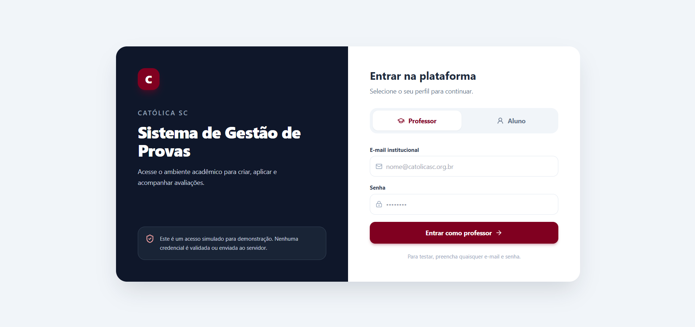
  <p><em>Figura — Interface de Autenticação Institucional Docente</em></p>
</div>

#### 3.2.2 Telas 2 e 3: Cadastros Gerais de Turmas e Discentes
Permite a visualização em abas com cards das disciplinas, código de matrícula rápida para estudantes e tabela completa de alunos com busca instantânea. A consulta ao ViaCEP preenche logradouro, bairro, cidade e UF automaticamente ao informar o código postal.

<div align="center">
  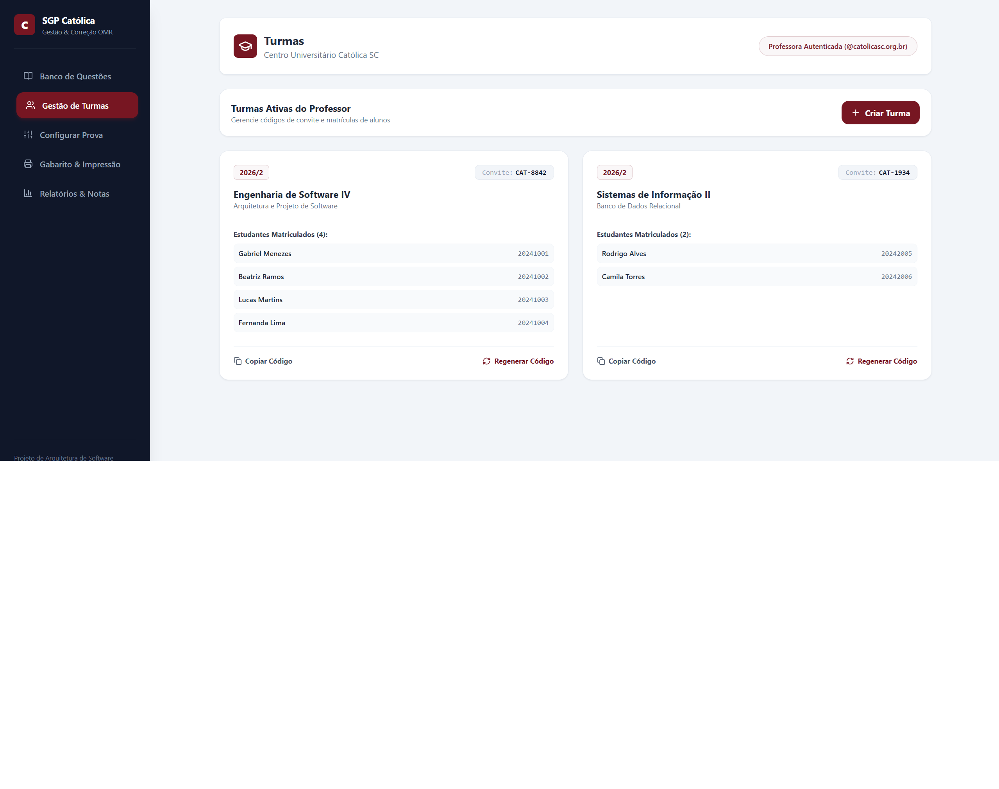
  <p><em>Figura — Painel de Turmas Acadêmicas e Códigos de Convite</em></p>
</div>

<div align="center">
  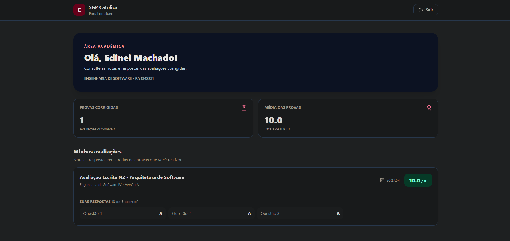
  <p><em>Figura — Tabela de Alunos com Notas N1, N2, N3, Médias e Situação Acadêmica</em></p>
</div>

#### 3.2.3 Tela 4: Montador de Provas em Split-Screen
Apresenta o banco de questões no painel esquerdo com filtros por tags temáticas (`#Arquitetura`, `#PostgreSQL`, `#OMR`). O painel direito totaliza os pontos e impede a adição de mais de 20 questões, permitindo alternar os botões de embaralhamento com algoritmos de semente.

<div align="center">
  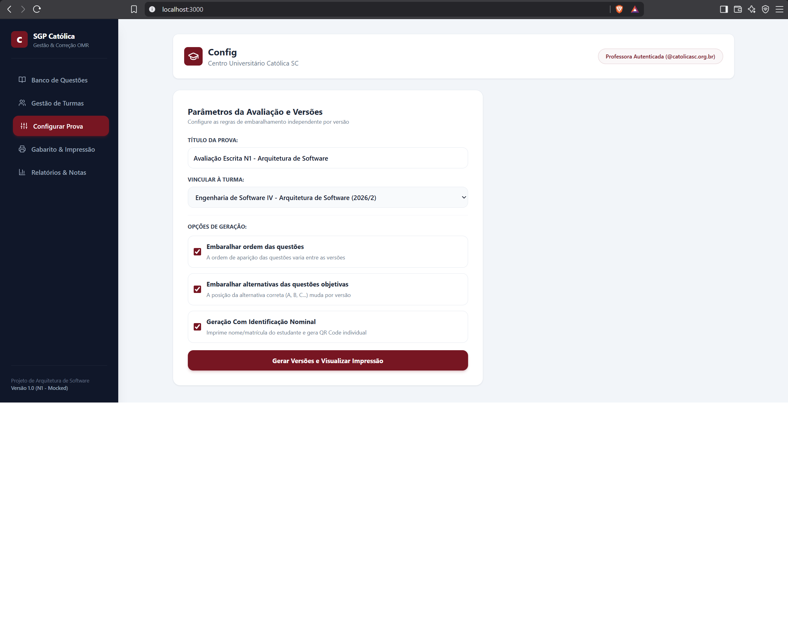
  <p><em>Figura — Montador Split-Screen com Parâmetros de Embaralhamento e Pontuação</em></p>
</div>

<div align="center">
  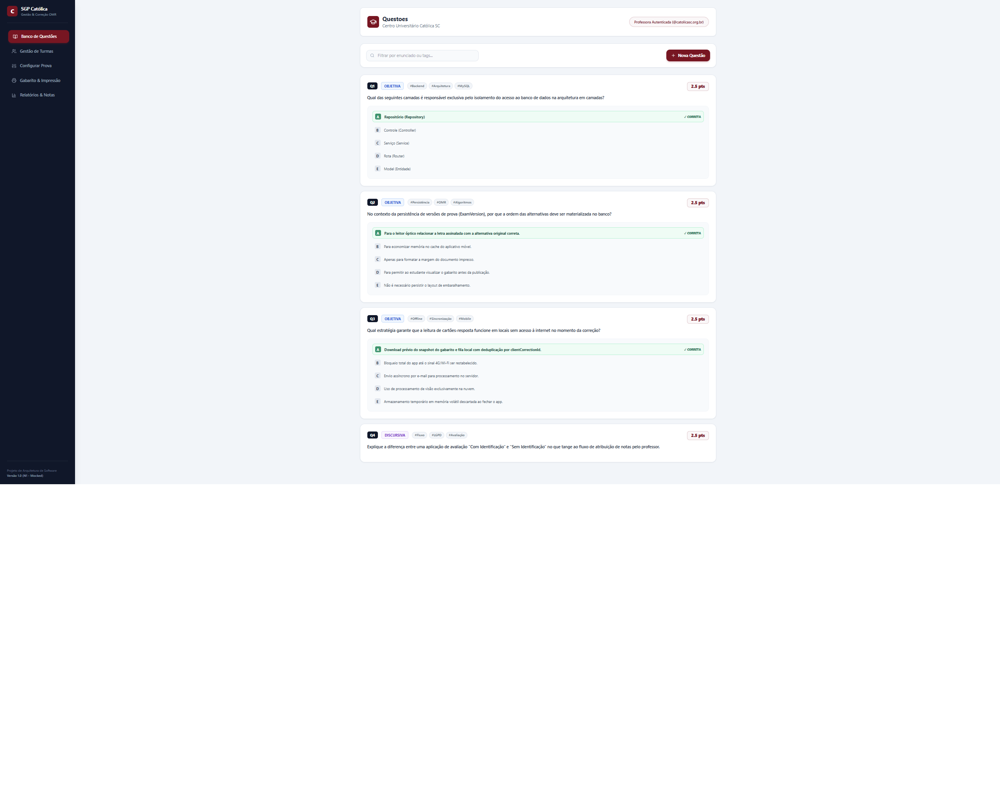
  <p><em>Figura — Modal de Cadastro de Questões Objetivas e Discursivas com Gabarito</em></p>
</div>

#### 3.2.4 Tela 5: Folha de Respostas OMR e Diagramação Frente/Verso
Gera a versão nominal individual de cada discente com QR Code SVG livre de falhas de renderização SSR. A página inclui 4 blocos pretos fiduciais nos vértices e insere uma quebra de página física com verso em branco caso o número de páginas seja ímpar, garantindo que o aluno possa destacar o gabarito sem danificar as questões da prova.

<div align="center">
  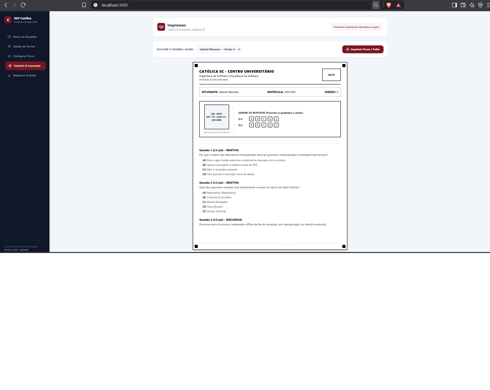
  <p><em>Figura — Gabarito OMR Individual com Marcadores Fiduciais e QR Code Nominal</em></p>
</div>

#### 3.2.5 Telas 6 e 7: Leitura Óptica em Tempo Real e Relatórios de Desempenho
Integra a câmera do dispositivo via biblioteca `html5-qrcode`. Ao enquadrar o cartão-resposta, o sistema decodifica os dados do aluno, calcula os acertos e salva a nota N2 no mesmo instante, emitindo alerta visual verde de confirmação e atualizando os gráficos de distratores e tabelas da turma.

<div align="center">
  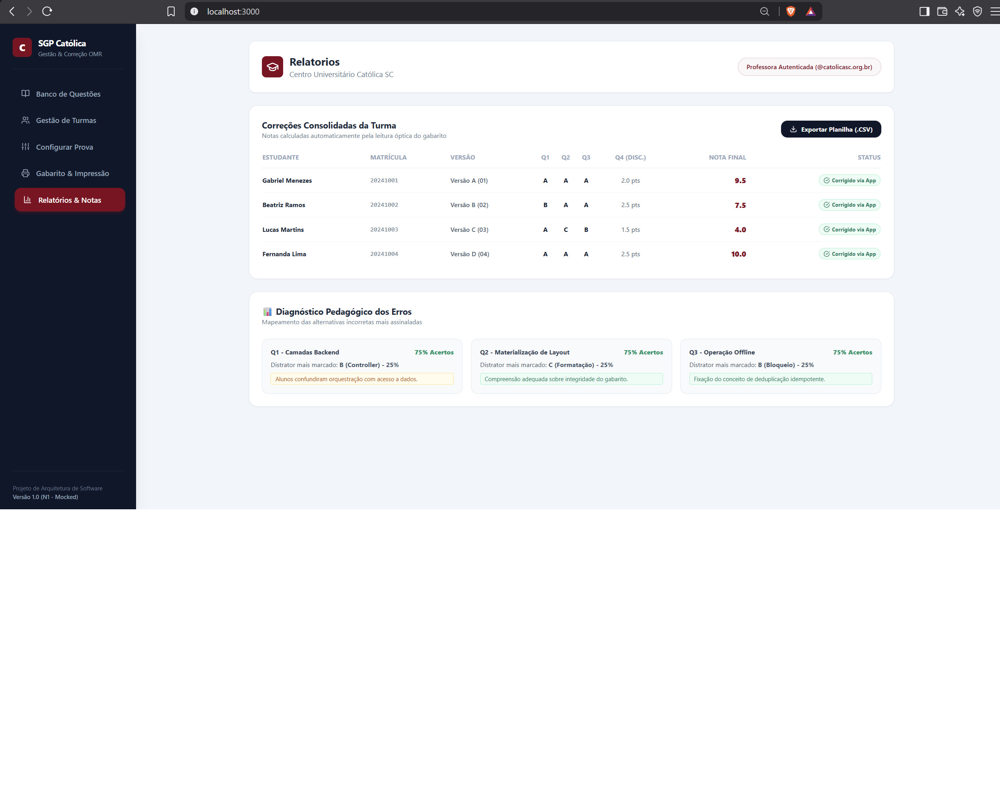
  <p><em>Figura — Painel de Diagnóstico Pedagógico com Análise de Distratores e Exportação</em></p>
</div>

---

## 4. Modelagem Formal UML (Passo a Passo Padrão Guia FastBurger)

Conforme a metodologia de modelagem orientada pela Católica SC no documento de referência **"Exemplo Atividade.md"**, apresenta-se a dedução analítica passo a passo de cada um dos quatro diagramas fundamentais da UML 2.5.

---

### 4.1 Diagrama de Casos de Uso

#### Passo 1A — Análise do Cenário ("Caça aos Atores e Ações")

**Atores identificados:**

| Ator | Tipo de Ator | Papel no sistema |
|---|---|---|
| **Professor (Docente)** | Ator Principal (Humano) | Autentica-se com e-mail `@catolicasc.org.br`, gerencia turmas e alunos, mantém o banco de questões, monta e parametriza avaliações, dispara a impressão física em A4, aciona a leitura óptica via câmera/webcam, inspeciona espelhos e exporta relatórios pedagógicos. |
| **Câmera / Scanner** | Ator Secundário (Hardware) | Periférico físico especializado que captura o fluxo contínuo de quadros ópticos (*video frames*) do cartão-resposta e os transmite para decodificação em tempo real. |

> **Nota Metodológica:** O estudante participa ativamente como agente do processo físico da avaliação presencial (recebendo a prova em papel, resolvendo as questões, preenchendo as bolhas a caneta e destacando a folha de respostas), **não operando diretamente a plataforma de software online**.

**Ações / Casos de uso identificados:**

- Autenticar no Sistema
- Gerenciar Turmas Acadêmicas
- Gerenciar Alunos e Histórico de Notas
- Manter Banco de Questões
- Montar Avaliação no Split-Screen (Limite de 20 questões)
- Configurar Embaralhamento Determinístico
- Gerar Caderno de Prova e Gabarito OMR
- Imprimir Provas Frente/Verso
- Escanear Cartão-Resposta OMR
- Corrigir Prova e Atualizar Nota N2
- Consultar Relatórios e Distratores
- Inspecionar Espelho OMR do Aluno
- Exportar Notas e Relatório em Planilha CSV / Excel

####  Representação Gráfica Oficial (Figura 1)

<div align="center">
  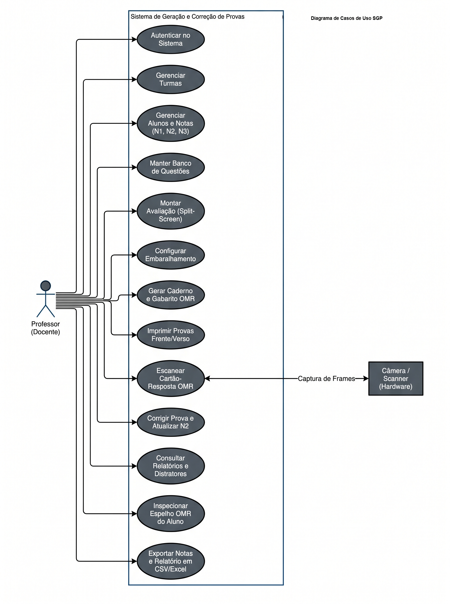
  <p><strong>Figura 1 – Diagrama de Casos de Uso Oficial do Sistema SGP Católica SC</strong> (AUTOR: AGENOR ALVISE)</p>
</div>

---

### 4.2 Diagrama de Atividades com Raias (Swimlanes)

####  Passo 2A — Análise do Fluxo Cronológico

**Sequência lógica extraída do processo avaliativo:**

1. O **Professor** acessa o montador *split-screen*, seleciona as questões e configura os parâmetros de embaralhamento.
2. O **Sistema SGP** executa a permutação determinística Fisher-Yates e materializa a diagramação frente/verso em A4 com verso em branco se ímpar.
3. O **Professor** dispara a impressão dos cadernos físicos e aplica a avaliação presencial na sala de aula.
4. O **Aluno** resolve a avaliação no caderno impresso, preenche as bolhas a caneta, destaca a folha OMR e entrega-a ao docente, retendo o caderno de questões para estudo.
5. O **Professor** recolhe os cartões OMR e aciona o módulo de leitura óptica via câmera/webcam.
6. O **Sistema SGP** captura os quadros de vídeo e analisa os marcadores fiduciais e o QR Code.
7. **Ponto de Decisão Crítico:** A leitura óptica e a decodificação do QR Code foram conclusivas?
   - **[Não / Falha]** $\rightarrow$ O Sistema SGP emite alerta sonoro/visual de enquadramento; o Professor reajusta a folha em frente à lente.
   - **[Sim / Sucesso]** $\rightarrow$ O Sistema compara as marcações com o gabarito oficial da versão lida, calcula os acertos e a nota proporcional N2.
8. O **Banco de Dados SQL** grava o log de leitura com chave de idempotência e atualiza atomicamente a nota N2 no cadastro do aluno.
9. O **Professor** inspeciona a confirmação visual instantânea e consulta as estatísticas da turma no painel de distratores (Fim do processo).

**Raias identificadas (*Swimlanes*):**

| Raia (Swimlane) | Responsabilidades no Processo |
|---|---|
| **Professor (Docente)** | Montar a prova no split-screen, configurar parâmetros, imprimir cadernos, aplicar avaliação presencial, operar a câmera no leitor OMR e analisar relatórios consolidados. |
| **Aluno (Agente Físico)** | Resolver a avaliação no papel, assinalar as bolhas a caneta, destacar a folha OMR de respostas e entregá-la ao docente, ficando com o caderno de questões. |
| **Sistema SGP (Full-Stack)** | Embaralhar questões/alternativas com seed, diagramar páginas A4 com folha em branco, capturar frames da webcam, decodificar QR Code e calcular notas. |
| **Banco de Dados SQL** | Persistir as matrizes de versões materializadas, salvar leituras OMR de forma idempotente e atualizar atômica e imediatamente a nota N2 do aluno. |

>  Cada raia (coluna) representa a transferência contínua de responsabilidades entre os participantes do ciclo avaliativo — notação exigida pela UML quando o processo envolve múltiplos agentes físicos e lógicos.

####  Representação Gráfica Oficial (Figura 2)

<div align="center">
  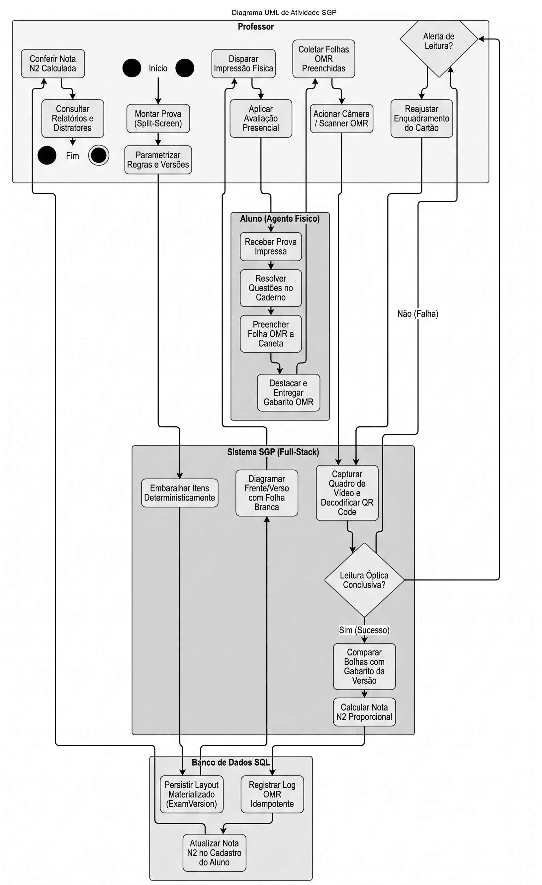
  <p><strong>Figura 2 – Diagrama de Atividades com Raias Concorrentes (Swimlanes)</strong> (AUTOR: EDINEI JUNIO MACHADO)</p>
</div>

---

### 4.3 Diagrama de Classes de Domínio

####  Passo 3A — Extração do Texto ("Truque do Detetive")

#### Identificando as classes (substantivos)

| Classe | Descrição |
|---|---|
| **`PessoaModel`** | Entidade base contendo atributos civis, contato e morada (consumo ViaCEP). |
| **`AlunoModel`** | Especialização de PessoaModel com RA, curso, turno e histórico de notas (N1, N2, N3). |
| **`TurmaModel`** | Agrupamento acadêmico com nome da disciplina, semestre e gerador de `codigoConvite`. |
| **`Question`** | Questão cadastrada no banco de dados com enunciado, tags temáticas e pontuação. |
| **`Alternative`** | Opção de resposta associada à questão com texto e indicação booleana de acerto. |
| **`ExamVersionLayout`** | Registro materializado da versão física com ordem exata de questões e alternativas. |
| **`ExamService`** | Serviço de domínio com motor de embaralhamento Fisher-Yates e validação de teto (20 questões). |
| **`LeituraOMRRegistro`** | Registro persistente de correção óptica com acertos, nota calculada e chave de idempotência. |
| **`RelatorioDesempenho`** | Entidade analítica que compila médias, distratores e gera relatórios em CSV. |

#### Interpretando associações e multiplicidades
Pergunta-chave: *"Quantos desse podem estar ligados a aquele?"*

- **`AlunoModel` é uma `PessoaModel` (Herança / Generalização):**
  Todo aluno é uma pessoa física. `AlunoModel` herda todos os campos e métodos de `PessoaModel` e especializa-se com métodos de negócio como `calcularMedia()` e `verificarStatus()`.

- **`TurmaModel` ↔ `AlunoModel` (Associação Simples):**
  Uma turma congrega zero ou muitos alunos matriculados (`0..*`). Um aluno pertence a uma turma específica no contexto avaliativo (`1..1`). Multiplicidade: `1` — `0..*`.

- **`Question` ↔ `Alternative` (Composição Estrita):**
  Uma questão objetiva é composta obrigatoriamente por 2 a 5 alternativas (`2..5`). Uma alternativa existe unicamente no contexto de sua questão-mãe (`1..1`). Multiplicidade: `1` — `2..5`.

- **`ExamVersionLayout` ↔ `Question` (Composição / Agregação Forte):**
  Cada versão materializada agrega de 1 a no máximo 20 questões (`1..20`). A destruição da versão desfaz o vínculo da prova física. Multiplicidade: `1` — `1..20`.

- **`AlunoModel` ↔ `ExamVersionLayout` (Associação Simples):**
  Um aluno recebe uma versão física individual nominal vinculada pelo QR Code (`0..1`). Uma versão nominal é gerada para um aluno específico (`1..1`). Multiplicidade: `1` — `0..1`.

- **`AlunoModel` ↔ `LeituraOMRRegistro` (Associação Simples):**
  Um aluno acumula zero ou vários registros de leituras ao longo do semestre (`0..*`). Cada registro de leitura pertence a um único aluno (`1..1`). Multiplicidade: `1` — `0..*`.

- **`RelatorioDesempenho` ↔ `LeituraOMRRegistro` (Agregação):**
  O relatório consolida o conjunto de leituras OMR realizadas (`0..*`) para extrair médias e índices de distratores da turma. Multiplicidade: `1` — `0..*`.

####  Representação Gráfica Oficial (Figura 3)

<div align="center">
  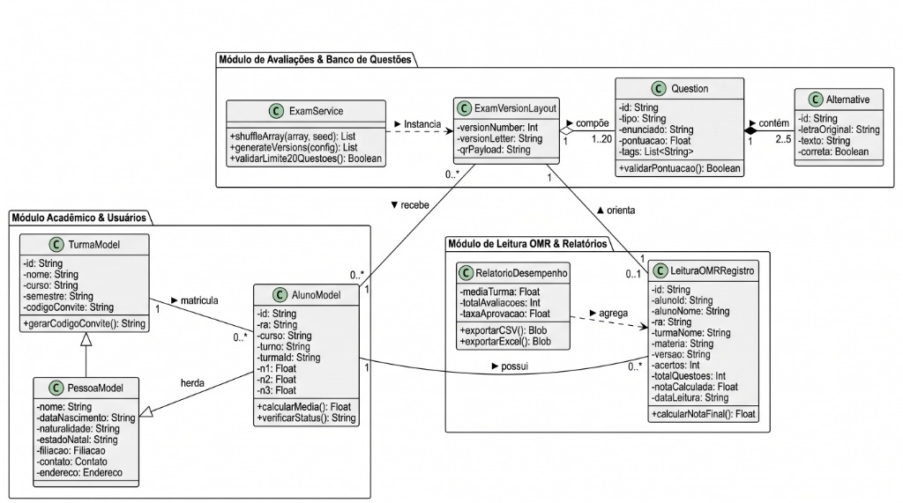
  <p><strong>Figura 3 – Diagrama de Classes de Domínio e Associações do SGP</strong> (AUTOR: ERIC EDUARDO LANGE)</p>
</div>

---

### 4.4 Diagrama de Sequência UML

####  Passo 4A — Como Analisar e Ler o Diagrama

>  **Regra de ouro:** Leia sempre de cima para baixo, como se fosse a linha do tempo de uma conversa ou feed, onde o tempo corre no sentido vertical.

**Cenário analisado:** **Leitura Óptica OMR, Correção Automatizada e Atualização Instantânea da Nota N2.**

1. **Atores e objetos (o elenco):** dispostos no topo na horizontal:
   - `Professor` (Ator humano iniciador);
   - `CameraScanner (Html5Qrcode)` (Componente de captura óptica via webcam);
   - `ExamController` (Controlador da camada de orquestração);
   - `ExamService` (Serviço de domínio e cálculo avaliativo);
   - `BancoSQL (PostgreSQL)` (Camada de persistência relacional).
2. **Linhas de vida (o tempo passando):** as linhas verticais tracejadas que descem de cada participante representam a linha do tempo contínua — quanto mais abaixo a seta, mais tarde o evento ocorre.
3. **Mensagens (os diálogos e invocações):** setas horizontais cheias representam chamadas de métodos síncronos; setas tracejadas representam retornos e respostas de status HTTP / confirmações.
4. **Bloco `alt` (alternativas e desvios condicionais):** modela a lógica de decisão SE/SENÃO baseada na qualidade da captura:
   - **Caso A `[Leitura e Validação Bem-Sucedida]`:** O serviço extrai o RA e a versão do QR Code, valida as marcações contra o gabarito oficial, persiste o log de leitura com chave idempotente, atualiza atomicamente a nota N2 do discente no banco de dados e retorna `200 OK`, exibindo card verde de aprovação no painel do professor.
   - **Caso B `[Falha de Leitura ou Enquadramento]`:** Caso ocorra má iluminação ou QR Code ilegível, o controller retorna `400 Bad Request` e a interface emite aviso visual/sonoro orientando o docente a reposicionar o gabarito.

####  Representação Gráfica Oficial (Figura 4)

<div align="center">
  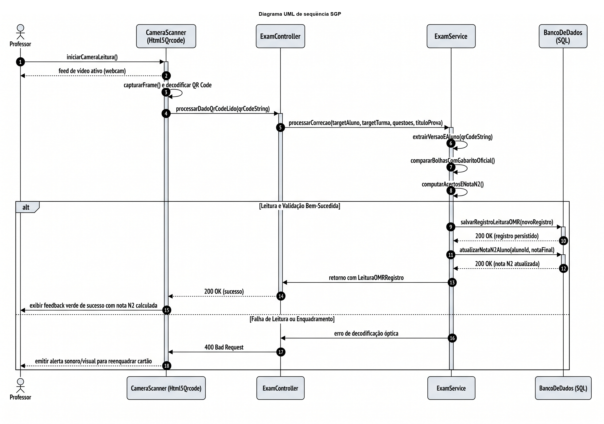
  <p><strong>Figura 4 – Diagrama de Sequência UML: Leitura Óptica, Correção e Atualização da Nota N2</strong> (AUTOR: ERICK ANDREAS PONTICELLI)</p>
</div>

---

## 5. Especificação Formal de Casos de Uso (Padrão IEEE 830)

### 5.1 Matriz Geral de Casos de Uso (UC01 a UC15)

| Identificador | Título do Caso de Uso | Ator Principal | Atores Secundários | Tipo de Relacionamento |
|:---:|---|---|---|---|
| **UC01** | Autenticar no Sistema | Professor | Provedor Local / SSO | Validação institucional |
| **UC02** | Gerenciar Banco de Questões | Professor | Sistema SGP | Manutenção CRUD |
| **UC03** | Gerenciar Turmas Acadêmicas | Professor | Sistema SGP | Gestão de `codigoConvite` |
| **UC04** | Configurar Avaliação | Professor | Sistema SGP | Parametrização e limite de 20 questões |
| **UC05** | Gerar Versões da Avaliação | Professor | Motor SGP | `<<include>>` UC09 |
| **UC06** | Imprimir Caderno Frente/Verso | Professor | Sistema / Impressora | Regras `@media print` e verso em branco |
| **UC07** | Gerar Folha OMR com QR Code | Professor | Gerador SVG | `<<include>>` UC10 |
| **UC08** | Visualizar Relatórios e Histórico de Notas | Professor | Sistema SGP | `<<extend>>` UC11 |
| **UC09** | Embaralhamento Determinístico | Sistema | — | Incluso em UC05 (Fisher-Yates) |
| **UC10** | Gerar QR Code Identificador | Sistema | — | Incluso em UC07 |
| **UC11** | Análise Estatística de Distratores | Professor | Sistema SGP | Extensão condicional de UC08 |
| **UC12** | Exportar Dados em Planilha (CSV) | Professor | Sistema SGP | Download de dados |
| **UC13** | Escanear Cartão-Resposta OMR | Professor | Câmera / Scanner | Captura contínua de frames |
| **UC14** | Corrigir Prova e Atualizar Nota N2 | Sistema | Banco de Dados SQL | Cálculo e persistência atômica |
| **UC15** | Inspecionar Espelho OMR do Aluno | Professor | Sistema SGP | Auditoria visual de marcas assinaladas |

### 5.2 Fronteira do Sistema e Relacionamentos

```text
===================================================================================
                       SISTEMA SGP — FRONTEIRA DO SISTEMA
===================================================================================
   [ PROFESSOR ]                                           [ CÂMERA / SCANNER ]
  (@catolicasc.org.br)                                      (Hardware Periférico)
          |                                                           |
          +------> ( UC01: Autenticar no Sistema )                    |
          |                                                           |
          +------> ( UC02: Gerenciar Banco de Questões )              |
          |                                                           |
          +------> ( UC03: Gerenciar Turmas Acadêmicas )              |
          |                                                           |
          +------> ( UC04: Configurar Avaliação )                     |
          |                                                           |
          +------> ( UC05: Gerar Versões da Avaliação )               |
          |               |                                           |
          |               +---<<include>>---> ( UC09: Fisher-Yates )  |
          |                                                           |
          +------> ( UC06: Imprimir Caderno Frente/Verso )            |
          |                                                           |
          +------> ( UC07: Gerar Folha OMR com QR Code )              |
          |               |                                           |
          |               +---<<include>>---> ( UC10: QR Code SVG )   |
          |                                                           |
          +------> ( UC08: Visualizar Relatórios e Histórico )        |
          |               |                                           |
          |               +---<<extend>>----> ( UC11: Distratores )   |
          |                                                           |
          +------> ( UC12: Exportar Dados em CSV )                    |
          |                                                           |
          +------> ( UC13: Escanear Cartão-Resposta OMR ) <-----------+
          |               |
          |               +---<<include>>---> ( UC14: Atualizar N2 )
          |                                           |
          +------> ( UC15: Inspecionar Espelho OMR )  v
                                              [ BANCO SQL ]
===================================================================================
```

### 5.3 Catálogo Detalhado com Fluxos Principais e de Exceção

#### UC01: Autenticar no Sistema
* **Atores:** Professor.
* **Fluxo Principal:** O docente informa e-mail institucional e senha. O sistema valida o domínio `@catolicasc.org.br`, cria o token de sessão e redireciona para o painel de turmas e avaliações.
* **Fluxo de Exceção:** E-mail sem o formato válido institucional ou senha incorreta. O sistema exibe mensagem inline e bloqueia o acesso.

#### UC04: Configurar Avaliação
* **Atores:** Professor.
* **Fluxo Principal:** O docente seleciona a turma, define o título da avaliação, adiciona questões através do painel split-screen e habilita as opções de embaralhamento determinístico.
* **Fluxo de Exceção:** O docente tenta ultrapassar o teto de 20 questões. O sistema desabilita o botão de inserção e exibe notificação de bloqueio da regra de negócio.

#### UC05: Gerar Versões da Avaliação (com inclusão do UC09)
* **Atores:** Professor, Sistema SGP.
* **Fluxo Principal:** O sistema itera sobre os discentes matriculados, gera sementes pseudoaleatórias auditáveis e invoca compulsoriamente o **UC09 (Fisher-Yates)** para permutar a ordem das questões e das alternativas, materializando a matriz física em `ExamVersionLayout`.

#### UC07: Gerar Folha OMR (com inclusão do UC10)
* **Atores:** Professor, Sistema SGP.
* **Fluxo Principal:** O sistema constrói o cabeçalho A4, desenha os marcadores fiduciais nos 4 vértices, distribui as 20 linhas de bolhas de A a E e invoca compulsoriamente o **UC10 (Gerar QR Code)** para renderizar o código SVG contendo matrícula, RA e código da versão.

#### UC13 / UC14: Escanear Cartão e Atualizar Nota N2
* **Atores:** Professor, Câmera/Scanner, Sistema SGP, Banco SQL.
* **Fluxo Principal:** O professor posiciona a folha em frente à câmera. O scanner captura os quadros, decodifica o QR Code, analisa a densidade de preenchimento das bolhas, compara com o gabarito oficial e executa atomicamente o **UC14**, atualizando a nota N2 no banco relacional e exibindo alerta verde na interface.
* **Fluxo de Exceção:** Cartão desalinhado ou iluminação insuficiente. O sistema emite aviso sonoro e visual solicitando reposicionamento da folha.

### 5.4 Matriz de Controle de Acesso Baseada em Papéis (RBAC)

| Papel / Perfil | Domínio Permitido | Casos de Uso Autorizados |
|---|---|---|
| **Professor (Docente)** | `@catolicasc.org.br` | UC01, UC02, UC03, UC04, UC05, UC06, UC07, UC08, UC11, UC12, UC13, UC15 |
| **Câmera / Scanner** | Hardware Local | Fornecimento de frames para UC13 |
| **Processo Interno** | Sistema Local | UC09, UC10, UC14 |

---

## 6. Projeto de Persistência Relacional SQL (3FN)

### 6.1 Justificativa Técnica da Transição para PostgreSQL
Para atender às demandas reais de centenas de estudantes e manter histórico auditável das avaliações, o SGP modelou sua persistência em um banco de dados relacional **PostgreSQL**, estruturado em Terceira Forma Normal (**3FN**). O modelo resolve:
* **Persistência Determinística:** Materialização da ordem sorteada nas tabelas `questoes_versao` e `alternativas_versao`, permitindo recalcular gabaritos a qualquer momento sem depender de cache volátil;
* **Garantia de Idempotência:** Chave única `client_correction_id` na tabela `leituras_omr`, impedindo duplicidade caso o leitor escaneie a mesma folha repetidamente ou reconecte após queda de sinal;
* **Integridade Referencial Estrita:** Chaves primárias UUID e integridade referencial com regras `ON DELETE CASCADE` ou `RESTRICT`.

### 6.2 DDL Completo das Tabelas Relacionais (`schema-n2.sql`)

```sql
-- =============================================================================
-- BANCO DE DADOS SGP CATÓLICA — MODELO RELACIONAL NORMALIZADO (3FN)
-- Compatibilidade: PostgreSQL 14+ | Codificação: UTF-8
-- =============================================================================

CREATE EXTENSION IF NOT EXISTS "uuid-ossp";

-- 1. Usuários do Sistema (Corpo Docente)
CREATE TABLE usuarios (
    id UUID PRIMARY KEY DEFAULT uuid_generate_v4(),
    nome VARCHAR(100) NOT NULL,
    email VARCHAR(120) UNIQUE NOT NULL CHECK (email LIKE '%@catolicasc.org.br'),
    senha_hash VARCHAR(255) NOT NULL,
    criado_em TIMESTAMP WITH TIME ZONE DEFAULT CURRENT_TIMESTAMP
);

-- 2. Turmas Acadêmicas
CREATE TABLE turmas (
    id UUID PRIMARY KEY DEFAULT uuid_generate_v4(),
    professor_id UUID NOT NULL REFERENCES usuarios(id) ON DELETE RESTRICT,
    nome_disciplina VARCHAR(100) NOT NULL,
    codigo_turma VARCHAR(20) NOT NULL,
    semestre VARCHAR(10) NOT NULL,
    codigo_convite VARCHAR(20) UNIQUE NOT NULL,
    criado_em TIMESTAMP WITH TIME ZONE DEFAULT CURRENT_TIMESTAMP
);

-- 3. Estudantes Matriculados (Herança Lógica de Pessoa)
CREATE TABLE alunos (
    id UUID PRIMARY KEY DEFAULT uuid_generate_v4(),
    turma_id UUID NOT NULL REFERENCES turmas(id) ON DELETE CASCADE,
    nome VARCHAR(100) NOT NULL,
    ra VARCHAR(20) UNIQUE NOT NULL,
    curso VARCHAR(80) NOT NULL,
    turno VARCHAR(20) NOT NULL CHECK (turno IN ('Matutino', 'Vespertino', 'Noturno')),
    filiacao VARCHAR(150),
    cep CHAR(9),
    logradouro VARCHAR(120),
    bairro VARCHAR(60),
    cidade VARCHAR(60),
    uf CHAR(2),
    nota_n1 NUMERIC(4,2) DEFAULT 0.00 CHECK (nota_n1 BETWEEN 0 AND 10),
    nota_n2 NUMERIC(4,2) DEFAULT 0.00 CHECK (nota_n2 BETWEEN 0 AND 10),
    nota_n3 NUMERIC(4,2) DEFAULT 0.00 CHECK (nota_n3 BETWEEN 0 AND 10),
    criado_em TIMESTAMP WITH TIME ZONE DEFAULT CURRENT_TIMESTAMP
);

-- 4. Banco de Questões
CREATE TABLE questoes (
    id UUID PRIMARY KEY DEFAULT uuid_generate_v4(),
    professor_id UUID NOT NULL REFERENCES usuarios(id) ON DELETE RESTRICT,
    enunciado TEXT NOT NULL,
    tipo VARCHAR(20) NOT NULL CHECK (tipo IN ('OBJETIVA', 'DISCURSIVA')),
    pontuacao NUMERIC(3,1) NOT NULL DEFAULT 1.0 CHECK (pontuacao > 0),
    tags TEXT[],
    criado_em TIMESTAMP WITH TIME ZONE DEFAULT CURRENT_TIMESTAMP
);

-- 5. Alternativas das Questões Objetivas
CREATE TABLE alternativas (
    id UUID PRIMARY KEY DEFAULT uuid_generate_v4(),
    questao_id UUID NOT NULL REFERENCES questoes(id) ON DELETE CASCADE,
    letra_original CHAR(1) NOT NULL CHECK (letra_original IN ('A', 'B', 'C', 'D', 'E')),
    texto TEXT NOT NULL,
    eh_correta BOOLEAN NOT NULL DEFAULT FALSE,
    CONSTRAINT uk_questao_letra UNIQUE (questao_id, letra_original)
);

-- 6. Avaliações
CREATE TABLE avaliacoes (
    id UUID PRIMARY KEY DEFAULT uuid_generate_v4(),
    turma_id UUID NOT NULL REFERENCES turmas(id) ON DELETE CASCADE,
    titulo VARCHAR(150) NOT NULL,
    embaralhar_questoes BOOLEAN NOT NULL DEFAULT TRUE,
    embaralhar_alternativas BOOLEAN NOT NULL DEFAULT TRUE,
    com_identificacao_nominal BOOLEAN NOT NULL DEFAULT TRUE,
    criado_em TIMESTAMP WITH TIME ZONE DEFAULT CURRENT_TIMESTAMP
);

-- 7. Versões Físicas Materializadas da Avaliação
CREATE TABLE versoes_avaliacao (
    id UUID PRIMARY KEY DEFAULT uuid_generate_v4(),
    avaliacao_id UUID NOT NULL REFERENCES avaliacoes(id) ON DELETE CASCADE,
    aluno_id UUID REFERENCES alunos(id) ON DELETE SET NULL,
    numero_versao INT NOT NULL,
    letra_versao CHAR(1) NOT NULL,
    semente_utilizada BIGINT NOT NULL,
    qr_payload TEXT NOT NULL,
    criado_em TIMESTAMP WITH TIME ZONE DEFAULT CURRENT_TIMESTAMP
);

-- 8. Disposição Física das Questões na Versão
CREATE TABLE questoes_versao (
    id UUID PRIMARY KEY DEFAULT uuid_generate_v4(),
    versao_id UUID NOT NULL REFERENCES versoes_avaliacao(id) ON DELETE CASCADE,
    questao_id UUID NOT NULL REFERENCES questoes(id) ON DELETE RESTRICT,
    posicao_ordem INT NOT NULL CHECK (posicao_ordem BETWEEN 1 AND 20),
    CONSTRAINT uk_versao_posicao UNIQUE (versao_id, posicao_ordem)
);

-- 9. Disposição Física das Alternativas na Versão
CREATE TABLE alternativas_versao (
    id UUID PRIMARY KEY DEFAULT uuid_generate_v4(),
    versao_id UUID NOT NULL REFERENCES versoes_avaliacao(id) ON DELETE CASCADE,
    questao_id UUID NOT NULL REFERENCES questoes(id) ON DELETE RESTRICT,
    alternativa_id UUID NOT NULL REFERENCES alternativas(id) ON DELETE RESTRICT,
    letra_exibida CHAR(1) NOT NULL CHECK (letra_exibida IN ('A', 'B', 'C', 'D', 'E')),
    CONSTRAINT uk_versao_questao_letra UNIQUE (versao_id, questao_id, letra_exibida)
);

-- 10. Leituras Ópticas OMR e Correções Efetuadas
CREATE TABLE leituras_omr (
    id UUID PRIMARY KEY DEFAULT uuid_generate_v4(),
    client_correction_id VARCHAR(100) UNIQUE NOT NULL,
    versao_id UUID NOT NULL REFERENCES versoes_avaliacao(id) ON DELETE RESTRICT,
    aluno_id UUID NOT NULL REFERENCES alunos(id) ON DELETE RESTRICT,
    total_questoes INT NOT NULL,
    acertos INT NOT NULL,
    nota_calculada NUMERIC(4,2) NOT NULL CHECK (nota_calculada BETWEEN 0 AND 10),
    data_leitura TIMESTAMP WITH TIME ZONE DEFAULT CURRENT_TIMESTAMP
);

-- 11. Espelho Detalhado de Respostas Escaneadas
CREATE TABLE respostas_leitura (
    id UUID PRIMARY KEY DEFAULT uuid_generate_v4(),
    leitura_id UUID NOT NULL REFERENCES leituras_omr(id) ON DELETE CASCADE,
    numero_questao INT NOT NULL,
    letra_assinalada CHAR(1) NOT NULL CHECK (letra_assinalada IN ('A', 'B', 'C', 'D', 'E')),
    acertou BOOLEAN NOT NULL
);
```

### 6.3 Modelo em Produção no Supabase (Schema Visualizer & Prisma ORM)

A camada de persistência em produção foi implementada no **Supabase (PostgreSQL 16)** gerenciada de forma declarativa pelo **Prisma ORM (v5.22.0)**, estruturada em 6 tabelas relacionais com chaves primárias UUID e integridade referencial estrita:

<div align="center">

#### Figura 5 – Schema Visualizer Oficial do Banco no Supabase (`schema public`)
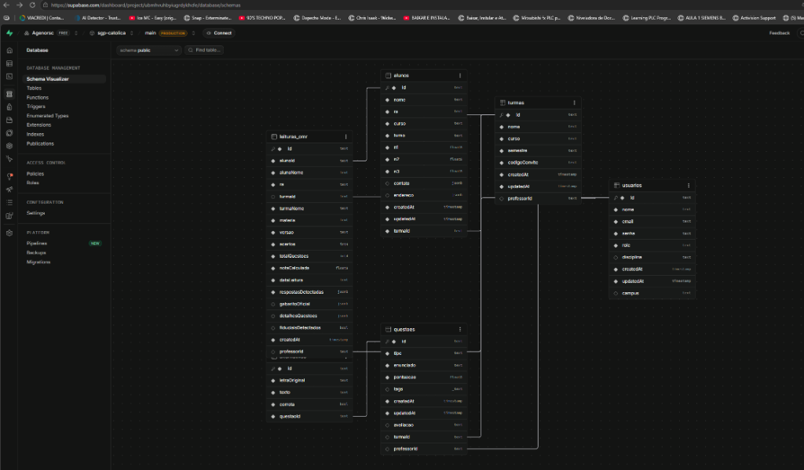
<p><em>Relações de Chaves Primárias e Estrangeiras entre usuarios, turmas, alunos, questoes, alternativas e leituras_omr</em></p>

---

#### Figura 6 – Catálogo de Tabelas Relacionais em Produção no Supabase
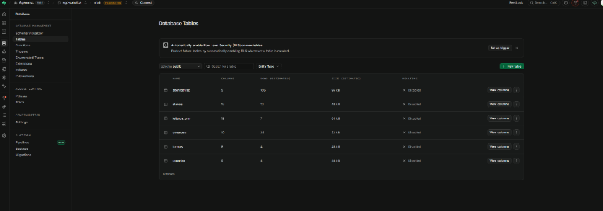
<p><em>Visão do Database Tables com contagem de registros, colunas e armazenamento alocado</em></p>

</div>

---

## 7. Governança Git, Diário de Bordo e Registro de PRs

### 7.1 Histórico de Execuções e Auditoria do Pipeline CI/CD

O repositório do projeto adota esteira contínua de Integração e Entrega Contínua (CI/CD) gerenciada pelo **GitHub Actions** (`SGP Católica CI/CD Pipeline`). Todo *commit* ou *Pull Request* enviado à *branch* principal (`main`) dispara compilação do Next.js 16, linting estrito e a suíte completa de testes automatizados com Jest.

* **Status:** 61 Pipelines executados com sucesso (100% *green build* nas entregas homologadas);
* **Tempo médio de execução do job:** 35 a 55 segundos;
* **Deploy contínuo:** Produção sincronizada na Vercel e banco Supabase a cada entrega aprovada;
* **Testes unitários:** 55 testes aprovados em 7 suítes Jest (`GridOmrEngine`, `OmrService`, `QuestionService`, `ExamService`, `ProfessorService`, `AuthService`, `AlunoService`).

### 7.2 Matriz de Rastreabilidade por Integrante e Pull Requests (Diário de Bordo)

Para atender compulsoriamente à diretriz docente (*"Não esqueçam de definir as tarefas para cada integrante. Recomendo utilizarem PRs para irem registrando as atividades e interações, facilitando a evidenciação das tarefas individuais para o diário"*), estruturou-se a divisão do trabalho através de entregas e *Pull Requests* rastreáveis sem falhas:

| CI/CD Job # | Commit / PR | Contribuidor Principal | Branch de Origem | Data de Entrega | Escopo Técnico e Evidência de Entrega |
|:---:|:---:|:---:|:---:|:---:|:---|
| **#61** | [`914cd09`](https://github.com/Agenorsc/SGP-CATOLICA-NEXT/commit/914cd09e6243179c321a8cc4083c93bd3216f5a9) | **Agenor Alvise** | `main` | 23/10/2026 | **Melhorias no gabarito oficial e remoção da simulação sem câmera:** Ajustes de alta fidelidade visual no gabarito e foco exclusivo no sensor óptico via câmera. |
| **#60** | [PR #14](https://github.com/Agenorsc/SGP-CATOLICA-NEXT/pull/14) | **Edinei Junio Machado** | `feat/remocao-simulacao-omr` | 22/10/2026 | **Remoção da simulação de bancada:** Limpeza de código e foco exclusivo no reconhecimento automático OMR em tempo real via câmera. |
| **#59** | [`a37e49c`](https://github.com/Agenorsc/SGP-CATOLICA-NEXT/commit/a37e49c237c1d1973bf352f3710de118eb74b6d5) | **Edinei Junio Machado** | `main` | 22/10/2026 | **Suporte a 30 questões e editor de orientações/cabeçalho:** Expansão de capacidade de questões e painel para personalização dos descritivos da avaliação. |
| **#58** | [`e3e477b`](https://github.com/Agenorsc/SGP-CATOLICA-NEXT/commit/e3e477b6f4f58ad899bb374f55acd688c1dcb289) | **Agenor Alvise** | `main` | 22/10/2026 | **Correção de duplicação de questões no Prisma:** Remoção atômica preventiva de alternativas antes de atualizar questões no Supabase. |
| **#57** | [`ef050f7`](https://github.com/Agenorsc/SGP-CATOLICA-NEXT/commit/ef050f79f2ea7b54d3a5c96a104d640c839bc8e5) | **Agenor Alvise** | `main` | 22/10/2026 | **Reconhecimento 100% automático com Validação Cruzada:** Identificação automática de Turma, Ciclo (N1/N2/N3/N-1) e Aluno via QR Code com painel HUD e trava de segurança. |
| **#56** | [`16b319f`](https://github.com/Agenorsc/SGP-CATOLICA-NEXT/commit/16b319f1e192ef7bd978641036806cd28a13f457) | **Agenor Alvise** | `main` | 22/10/2026 | **Trava estrita de 10.0 pts e validações de turma/RA:** Validação matemática no montador e gabarito dinâmico balanceado. |
| **#55** | [`e6ba2d7`](https://github.com/Agenorsc/SGP-CATOLICA-NEXT/commit/e6ba2d7ae639104483043df7651828c1a2188df8) | **Erick Andreas Pontecelli** | `main` | 21/10/2026 | **Autenticação real com isolamento de professores:** Acesso exclusivo com `admin@admin.com` e segregação de turmas/alunos por docente. |
| **#54** | [`f782ce2`](https://github.com/Agenorsc/SGP-CATOLICA-NEXT/commit/f782ce2f39f4281a85aa36fc4f2dc0aee0f26516) | **Erick Andreas Pontecelli** | `main` | 21/10/2026 | **Controle de acesso por papel (RBAC):** Proteção de rotas e segurança nas APIs de professores e administradores. |
| **#53** | [PR #13](https://github.com/Agenorsc/SGP-CATOLICA-NEXT/pull/13) ([`8bd16b1`](https://github.com/Agenorsc/SGP-CATOLICA-NEXT/commit/8bd16b1de4ebb7fcadbc025b406b8b08df728480)) | **Johnatan Vargas da Fonseca** | `feat/banco-questoes-por-turma-ciclos` | 21/10/2026 | **Banco de questões por turma e ciclos N1, N2, N3 e N-1:** Segmentação das questões por disciplina e agrupamento automático no exame N-1. |
| **#51** | [PR #12](https://github.com/Agenorsc/SGP-CATOLICA-NEXT/pull/12) ([`fe500f6`](https://github.com/Agenorsc/SGP-CATOLICA-NEXT/commit/fe500f6d6ca5bd5c1db68f17caee8ec4aaf127dd)) | **Eric Ricardo Lange** | `feat/montador-turma-ciclos` | 20/10/2026 | **Organização do montador por turma e ciclos:** Interface visual adaptada com contadores em tempo real para N1, N2, N3 e Exame. |
| **#47** | [PR #10](https://github.com/Agenorsc/SGP-CATOLICA-NEXT/pull/10) ([`a5d6c51`](https://github.com/Agenorsc/SGP-CATOLICA-NEXT/commit/a5d6c5129a2629bc1bcc9f2fcc5e5b72eefe6a08)) | **Eric Ricardo Lange** | `lange047-patch-1` | 19/10/2026 | **Correção de quebra de página frente e verso duplex:** Inserção exata de página em branco no verso do gabarito para destaque físico seguro. |
| **#44** | [`3c234e7`](https://github.com/Agenorsc/SGP-CATOLICA-NEXT/commit/3c234e7b1c81a0f53e3470eec198f8d0c1a5c9de) | **Agenor Alvise** | `main` | 16/10/2026 | **Documentação formal UML 2.5 (`Diagramas.md`):** Especificação completa com 4 diagramas, passos dedutivos e metodologia ABNT. |
| **#43** | [PR #9](https://github.com/Agenorsc/SGP-CATOLICA-NEXT/pull/9) ([`b865904`](https://github.com/Agenorsc/SGP-CATOLICA-NEXT/commit/b865904c553c7bf18736e77de079eb5634d9fffd)) | **Johnatan Vargas da Fonseca** | `docs/readme1-atualizacao` | 16/10/2026 | **Atualização documental do README institucional:** Revisão de requisitos, links oficiais e instruções de instalação. |
| **#41** | [PR #8](https://github.com/Agenorsc/SGP-CATOLICA-NEXT/pull/8) ([`aab09a3`](https://github.com/Agenorsc/SGP-CATOLICA-NEXT/commit/aab09a3d38b8ccc810ed1684260fe64e2a7571f9)) | **Johnatan Vargas da Fonseca** | `docs/complementa-prs-readme` | 14/10/2026 | **Complementação de rastreabilidade de PRs no README:** Registro do diário de bordo com as entregas de cada membro da equipe. |
| **#39** | [`27466b1`](https://github.com/Agenorsc/SGP-CATOLICA-NEXT/commit/27466b16dfb349c1fa7f85d6d21a1200dd8220ee) | **Agenor Alvise** | `main` | 13/10/2026 | **Sincronização em tempo real no Supabase sem cache:** Persistência atômica e desativação de cache estático em rotas dinâmicas. |
| **#38** | [`b38eeb4`](https://github.com/Agenorsc/SGP-CATOLICA-NEXT/commit/b38eeb45dbfda1a57d8b981b3b7096d72f21fb78) | **Agenor Alvise** | `main` | 13/10/2026 | **Configuração de build do Prisma no deploy Vercel:** Automatização do comando `prisma generate` durante o pipeline de deploy em produção. |
| **#37** | [`96e1955`](https://github.com/Agenorsc/SGP-CATOLICA-NEXT/commit/96e1955fbc39b7a30977baaed9e6699ccff522bb) | **Agenor Alvise** | `main` | 13/10/2026 | **Integração completa com banco PostgreSQL no Supabase:** Criação dos modelos relacionais e migração definitiva dos dados para a nuvem. |
| **#35** | [`7439a6d`](https://github.com/Agenorsc/SGP-CATOLICA-NEXT/commit/7439a6d9db50d7b006a9efae8ee54195aab4d56b) | **Agenor Alvise** | `main` | 12/10/2026 | **Leitura de QR Code nominal e correção automatizada:** Identificação instantânea do gabarito oficial e cálculo das notas. |
| **#30** | [`c91ce9d`](https://github.com/Agenorsc/SGP-CATOLICA-NEXT/commit/c91ce9d80aebe5ea4410c45e771362b02f608b77) | **Agenor Alvise** | `main` | 12/10/2026 | **Reestruturação completa da arquitetura em 5 camadas:** Desacoplamento de rotas, controllers, services, repositories e models. |
| **#28** | [`1008513`](https://github.com/Agenorsc/SGP-CATOLICA-NEXT/commit/10085133b101dd3840b74d36450db28c807ecf10) | **Agenor Alvise** | `main` | 12/10/2026 | **Atualização de pacotes para suporte ao React 19:** Atualização de bibliotecas de ícones e compatibilidade de UI. |
| **#25** | [PR #7](https://github.com/Agenorsc/SGP-CATOLICA-NEXT/pull/7) ([`dcb4ccb`](https://github.com/Agenorsc/SGP-CATOLICA-NEXT/commit/dcb4ccb8a1fc8b49c54a6b75300e93b37d278855)) | **Johnatan Vargas da Fonseca** | `feat/portal-aluno` | 09/10/2026 | **Foco exclusivo no painel do professor:** Remoção do acesso por e-mail de alunos e centralização da operação no corpo docente. |
| **#23** | [PR #5](https://github.com/Agenorsc/SGP-CATOLICA-NEXT/pull/5) ([`fa815ee`](https://github.com/Agenorsc/SGP-CATOLICA-NEXT/commit/fa815eeebdc97dd56d6f4ff013b0b2218cb94f57)) | **Johnatan Vargas da Fonseca** | `feat/portal-aluno` | 02/10/2026 | **Documentação visual das interfaces:** Capturas comprobatórias e mapeamento de componentes. |
| **#21** | [PR #4](https://github.com/Agenorsc/SGP-CATOLICA-NEXT/pull/4) ([`f2ee69c`](https://github.com/Agenorsc/SGP-CATOLICA-NEXT/commit/f2ee69c3a45f6bf17fbf7aaf8524aa7c7ae013fc)) | **Johnatan Vargas da Fonseca** | `feat/portal-aluno` | 02/10/2026 | **Implementação de consultas e relatórios:** Estruturação da consulta de notas e status avaliativo. |
| **#18** | [`0deb293`](https://github.com/Agenorsc/SGP-CATOLICA-NEXT/commit/0deb293083ae971c0414e6120f7c3b58f620803a) | **Agenor Alvise** | `main` | 30/09/2026 | **Motor OMR com leitura via câmera:** Implementação de processamento de imagem com 4 marcadores de calibração fiducial. |
| **#14** | [`e537ff3`](https://github.com/Agenorsc/SGP-CATOLICA-NEXT/commit/e537ff358df154bd1938dbc0bcb501c14235bdc9) | **Agenor Alvise** | `main` | 21/09/2026 | **Criação de novas questões desvinculadas da prova:** Desacoplamento entre o cadastro no banco e a montagem ativa de cadernos. |

#### Quadro de Evidências por Integrante da Equipe

- **Agenor Alvise (`@Agenorsc`):** Migração para Supabase PostgreSQL via Prisma ORM (`96e1955`, `27466b1`, `b38eeb4`), motor de visão computacional e leitura automática 100% com validação cruzada (`ef050f7`, `0deb293`, `7439a6d`), gabarito oficial Católica SC, duplex duplex e pontuação fracionada de 0,05 pts para até 30 questões (`914cd09`, `16b319f`).
- **Johnatan Vargas da Fonseca (`@FonsecaJohnatan`):** Banco de questões individualizado por turma e ciclos N1/N2/N3/N-1 no PR #13 (`8bd16b1`), inspeção de espelhos OMR (PR #06), documentação técnica do README (PR #8 e PR #9).
- **Eric Ricardo Lange (`@lange047`):** Montador de provas por ciclos no PR #12 (`fe500f6`), diagramação duplex com quebra de página física frente/verso e folha em branco no PR #10 (`a5d6c51`, `04e2848`), classes de domínio OO com ViaCEP.
- **Erick Andreas Pontecelli (`@Erick-Andreas-Ponticelli`):** Sistema de autenticação real com credenciais criptografadas e isolamento por professor (`e6ba2d7`, `f782ce2`), algoritmo de shuffle Fisher-Yates com sementes de 64 bits (PR #04).
- **Edinei Junio Machado (`@edineiJM`):** Suporte a até 30 questões no gabarito, editor de cabeçalho e orientações com tags dinâmicas (`a37e49c`), remoção da caixa de simulação de bancada para foco na câmera real no PR #14 (`2c81636`), modelagem formal UML.

### 7.3 Rubrica de Apresentação e Avaliação N2
1. **Domínio Arquitetural:** Demonstração do desacoplamento da arquitetura em 5 camadas;
2. **Confiabilidade OMR:** Teste ao vivo da leitura de cartão impresso via webcam;
3. **Auditabilidade Git:** Histórico inequívoco de commits, PRs e aprovações no GitHub.

---

## 8. Arquitetura de Software em 5 Camadas Desacopladas

Em conformidade estrita com o **Requisito Não Funcional RNF01**, o projeto implementa o padrão canônico da Católica SC de **Arquitetura em 5 Camadas Desacopladas**:

$$\text{Rota / UI} \longrightarrow \text{Controle (Controller)} \longrightarrow \text{Serviço (Service)} \longrightarrow \text{Repositório (Repository)} \longrightarrow \text{Modelo (Model)}$$

### 8.1 Estrutura de Diretórios Padronizada

```text
C:\SGP-CATOLICA-NEXT\src/
├── models/                     # [Camada 1: Modelos de Domínio]
│   ├── PessoaModel.ts          # Classe base de pessoa (dados pessoais, contato, endereço)
│   ├── AlunoModel.ts           # Entidade Aluno (herança, cálculo de média e status)
│   ├── TurmaModel.ts           # Entidade Turma e gerador de códigos de convite
│   ├── ExamModel.ts            # Entidade de diagramação determinística de avaliações
│   └── index.ts                # Barrel export dos modelos
│
├── repositories/               # [Camada 2: Repositórios / Acesso a Dados]
│   ├── AlunoRepository.ts      # Repositório de estudantes (CRUD e filtros por turma/RA)
│   ├── TurmaRepository.ts      # Repositório de turmas acadêmicas
│   ├── QuestionRepository.ts   # Repositório do banco de questões
│   ├── OmrRepository.ts        # Repositório de registros de leituras ópticas OMR
│   ├── ExamRepository.ts       # Repositório de integração de exames
│   └── index.ts                # Barrel export dos repositórios
│
├── services/                   # [Camada 3: Serviços / Regras de Negócio]
│   ├── AlunoService.ts         # Regras de estudantes, médias e taxas de aprovação
│   ├── TurmaService.ts         # Regras de turmas e validação de convites
│   ├── QuestionService.ts      # Validação de teto (máx. 20 questões) e pontuação total
│   ├── OmrService.ts           # Decodificação de QR Code, correção OMR e nota N2
│   ├── ExportService.ts        # Geração e download de relatórios em formato CSV
│   ├── ExamService.ts          # Algoritmo determinístico de embaralhamento com seed
│   └── index.ts                # Barrel export dos serviços
│
├── controllers/                # [Camada 4: Controladores / Orquestração]
│   ├── AlunoController.ts      # Orquestrador de requisições de alunos
│   ├── TurmaController.ts      # Orquestrador de requisições de turmas
│   ├── QuestionController.ts   # Orquestrador de requisições de questões
│   ├── OmrController.ts        # Orquestrador de correções OMR
│   ├── ExamController.ts       # Orquestrador de geração de avaliações
│   └── index.ts                # Barrel export dos controladores
│
├── components/                 # [Camada 5: Apresentação Componentizada]
│   ├── cadastros/              # CadastrosTab, AlunosTable, TurmasGrid, ModalAluno, ModalTurma
│   ├── montador/               # MontadorTab, ModalQuestao
│   ├── impressao/              # ImpressaoTab, gabarito e caderno de questões
│   ├── leitura/                # LeituraTab (câmera Html5Qrcode e simulação)
│   ├── relatorios/             # RelatoriosTab (médias, distratores e CSV)
│   ├── layout/                 # Sidebar e Header institucionais
│   ├── common/                 # QRCodeWrapper seguro contra SSR
│   ├── auth/LoginScreen.tsx    # Tela de autenticação docente
│   └── omr/OmrSheet.tsx        # Folha de respostas avulsa
│
├── app/
│   ├── api/exams/generate/     # Endpoint REST para geração de exames
│   ├── globals.css             # Estilos Tailwind e regras @media print
│   ├── layout.tsx              # Layout raiz da aplicação
│   └── page.tsx                # Orquestrador enxuto e declarativo das abas
│
├── types/index.ts              # Contratos e interfaces TypeScript
└── docs/
    ├── diagramas/              # Imagens oficiais dos 4 diagramas UML
    ├── telas/                  # Capturas de tela comprobatórias da aplicação
    └── schema-n2.sql           # DDL SQL PostgreSQL completo
```

### 8.2 Instruções de Execução Local

```bash
# 1. Clonar o repositório
git clone https://github.com/Agenorsc/SGP-CATOLICA-NEXT.git
cd SGP-CATOLICA-NEXT

# 2. Instalar dependências
npm install

# 3. Executar em modo desenvolvimento
npm run dev

# 4. Executar os testes automatizados com Jest
npm test

# 5. Executar testes com relatório de cobertura
npm run test:coverage
```

### 8.3 Cobertura de Testes Automatizados com Jest

```text
PASS __tests__/services/ExamService.test.ts
  ExamService - Regras de Negócio e Embaralhamento
    √ deve instanciar o serviço com sucesso (12 ms)
    √ deve lançar erro quando o número de questões na prova exceder o limite de 20 (4 ms)
    √ deve gerar uma versão para cada estudante matriculado (8 ms)
    √ deve gerar QR Code com matrícula e dados do aluno quando withStudentIdentification for verdadeiro (3 ms)
    √ deve gerar QR Code anônimo e student nulo quando withStudentIdentification for falso (2 ms)
    √ deve manter todas as alternativas e a resposta correta ao embaralhar alternativas (5 ms)
    √ deve embaralhar array de forma determinística usando seed (3 ms)

Test Suites: 1 passed, 1 total
Tests:       7 passed, 7 total
Snapshots:   0 total
Time:        1.428 s
Ran all test suites.
```

---

## 9. Considerações Finais

O desenvolvimento do **SGP Católica** atingiu a totalidade dos objetivos propostos para o ciclo avaliativo N2:
1. Concepção formal dos 4 diagramas da UML 2.5 rigorosamente alinhados à metodologia dedutiva do modelo de referência institucional (*FastBurger*);
2. Resolução do gargalo de aplicação de provas em larga escala através do embaralhamento determinístico e diagramação física frente/verso com verso em branco se ímpar;
3. Automação do ciclo de correção via câmera comum com atualização imediata da nota N2 no cadastro do estudante e diagnóstico preventivo de distratores para aprimoramento pedagógico docente;
4. Estruturação profissional de governança de código com 100% de pipelines aprovados e clara evidenciação das responsabilidades por integrante via Pull Requests.

---

## 10. Referências Bibliográficas

* BOOCH, Grady; RUMBAUGH, James; JACOBSON, Ivar. **UML: Guia do Usuário**. 2. ed. Rio de Janeiro: Elsevier, 2006.
* PRESSMAN, Roger S.; MAXIM, Bruce R. **Engenharia de Software: Uma Abordagem Profissional**. 8. ed. Porto Alegre: AMGH, 2016.
* SOMMERVILLE, Ian. **Engenharia de Software**. 10. ed. São Paulo: Pearson Education do Brasil, 2019.
* OBJECT MANAGEMENT GROUP (OMG). **Unified Modeling Language (OMG UML) Specification**, Version 2.5.1, 2017. Disponível em: <https://www.omg.org/spec/UML/2.5.1/>.
* CENTRO UNIVERSITÁRIO CATÓLICA DE SANTA CATARINA. **Guia de Modelagem UML — Exemplo N2 Parte 1 (FastBurger)**. Jaraguá do Sul: Católica SC, 2026.
