<div align="center">

# CENTRO UNIVERSITÁRIO CATÓLICA DE SANTA CATARINA
### CURSO DE BACHARELADO EM ENGENHARIA DE SOFTWARE
### DISCIPLINA DE ENGENHARIA DE SOFTWARE / ARQUITETURA DE SOFTWARE

---

# SISTEMA DE GERAÇÃO E CORREÇÃO DE PROVAS (SGP CATÓLICA)
### Relatório Técnico, Documentação de Arquitetura e Engenharia de Software — Avaliação N2

 **Aplicação em Produção (Vercel):** [https://sgp-catolica-next.vercel.app/](https://sgp-catolica-next.vercel.app/)  
 **Repositório Oficial:** [https://github.com/Agenorsc/SGP-CATOLICA-NEXT](https://github.com/Agenorsc/SGP-CATOLICA-NEXT)

[](https://nextjs.org/)
[](https://react.dev/)
[](https://www.typescriptlang.org/)
[](https://tailwindcss.com/)
[](https://jestjs.io/)
[](https://nodejs.org/)
[](https://www.postgresql.org/)

[](https://github.com/Agenorsc/SGP-CATOLICA-NEXT/actions)
[](https://catolicasc.org.br/)
[](https://catolicasc.org.br/)

**Jaraguá do Sul – SC | 2026**

</div>

---

##  Equipe de Desenvolvimento e Matriz de Autores

| Integrante | Papel / Especialidade Principal | Escopo Técnico Central no Repositório |
|---|---|---|
| **Agenor Alvise** | Front-end Lead & Arquitetura | Diagramação para impressão frente/verso, gabaritos OMR em A4, testes unitários com Jest, pipeline de CI/CD e refatoração em camadas desacopladas. |
| **Johnatan Vargas da Fonseca** | Engenheiro Full-Stack | Gestão de turmas com código institucional, banco de questões com filtros dinâmicos, navegação responsiva mobile e inspeção de espelhos OMR. |
| **Eric Ricardo Lange** | Modelagem Orientada a Objetos | Entidades de domínio (`PessoaModel` $\rightarrow$ `AlunoModel`), consumo da API ViaCEP, validação cadastral e documentação de integração. |
| **Erick Andreas Pontecelli** | Algoritmos & Visão Computacional | Algoritmos determinísticos de embaralhamento com sementes (*seeds*), matrizes OMR e leitura óptica via câmara/webcam com decodificação QR Code. |
| **Edinei Junio Machado** | Engenharia de Requisitos & Dados | Levantamento com o docente Samuel, modelagem formal UML (Casos de Uso, Atividades, Classes, Sequência), DDL relacional SQL e governança Git. |

* **Docente Avaliador / Cliente:** Prof. Me. Samuel
* **Orientação Pedagógica:** Centro Universitário Católica de Santa Catarina (Católica SC) — Câmpus Jaraguá do Sul

---

##  Resumo Executivo

O presente documento técnico-acadêmico consolida a concepção, os requisitos, o modelo arquitetural em 5 camadas, a persistência relacional normalizada e a modelagem formal em Linguagem de Modelagem Unificada (UML 2.5) do **Sistema de Geração e Correção de Provas (SGP)**. Desenvolvido para atender às demandas didático-pedagógicas do Centro Universitário Católica de Santa Catarina, o projeto moderniza e otimiza a rotina avaliativa docente diante de ciclos com 200 a 400 estudantes simultâneos por semestre letivo.

A solução elimina a vulnerabilidade de fraudes acadêmicas e a exaustão operacional através de:
1. Composição de provas em *split-screen* com restrição estrita de até 20 questões por caderno e balanceamento automático de notas;
2. Algoritmo determinístico de permutação Fisher-Yates com sementes auditáveis de 64 bits para embaralhamento independente de questões e alternativas por estudante;
3. Motor de diagramação física inteligente em folha A4 com regras CSS `@media print`, separando a folha de respostas OMR destacável e injetando uma página em branco no verso caso o número de páginas seja ímpar;
4. Leitor óptico de marcas (OMR) e decodificador bidimensional de QR Code em tempo real via navegador e câmara/webcam (`html5-qrcode`);
5. Cálculo atômico e atualização instantânea da nota bimestral N2 no histórico acadêmico do aluno;
6. Módulo analítico de distratores para apoio pedagógico ao docente e exportação de dados consolidados em formatos CSV e planilhas eletrônicas.

**Palavras-chave:** Engenharia de Software. Reconhecimento Óptico de Marcas (OMR). Modelagem UML. Next.js 16. Arquitetura em Camadas. Gestão Docente.

---

##  Sumário

- [1. Introdução](#1-introdução)
  - [1.1 Contexto e Justificativa Institucional](#11-contexto-e-justificativa-institucional)
  - [1.2 Delimitação do Problema](#12-delimitação-do-problema)
  - [1.3 Objetivos Geral e Específicos](#13-objetivos-geral-e-específicos)
- [2. Engenharia de Requisitos do Sistema](#2-engenharia-de-requisitos-do-sistema)
  - [2.1 Requisitos Funcionais (RF01 a RF16)](#21-requisitos-funcionais-rf01-a-rf16)
  - [2.2 Requisitos Não Funcionais (RNF01 a RNF07)](#22-requisitos-não-funcionais-rnf01-a-rnf07)
- [3. Mapeamento e Especificação Visual de Telas](#3-mapeamento-e-especificação-visual-de-telas)
  - [3.1 Matriz de Componentes e Telas da Aplicação](#31-matriz-de-componentes-e-telas-da-aplicação)
  - [3.2 Detalhamento Operacional das Interfaces](#32-detalhamento-operacional-das-interfaces)
- [4. Modelagem Formal UML (Análise Minuciosa dos Diagramas)](#4-modelagem-formal-uml-análise-minuciosa-dos-diagramas)
  - [4.1 Diagrama de Casos de Uso (Figura 1)](#41-diagrama-de-casos-de-uso-figura-1)
  - [4.2 Diagrama de Atividades com Raias Concorrentes (Figura 2)](#42-diagrama-de-atividades-com-raias-concorrentes-figura-2)
  - [4.3 Diagrama de Classes de Domínio e Associações (Figura 3)](#43-diagrama-de-classes-de-domínio-e-associações-figura-3)
  - [4.4 Diagrama de Sequência — Leitura OMR e Atualização N2 (Figura 4)](#44-diagrama-de-sequência--leitura-omr-e-atualização-n2-figura-4)
- [5. Especificação Formal de Casos de Uso (Padrão IEEE 830)](#5-especificação-formal-de-casos-de-uso-padrão-ieee-830)
  - [5.1 Matriz Geral de Casos de Uso (UC01 a UC15)](#51-matriz-geral-de-casos-de-uso-uc01-a-uc15)
  - [5.2 Fronteira do Sistema e Relacionamentos](#52-fronteira-do-sistema-e-relacionamentos)
  - [5.3 Catálogo Detalhado com Fluxos Principais e de Exceção](#53-catálogo-detalhado-com-fluxos-principais-e-de-exceção)
  - [5.4 Matriz de Controle de Acesso Baseada em Papéis (RBAC)](#54-matriz-de-controle-de-acesso-baseada-em-papéis-rbac)
- [6. Projeto de Persistência Relacional SQL (3FN)](#6-projeto-de-persistência-relacional-sql-3fn)
  - [6.1 Justificativa Técnica da Transição para PostgreSQL](#61-justificativa-técnica-da-transição-para-postgresql)
  - [6.2 DDL Completo das Tabelas Relacionais (`schema-n2.sql`)](#62-ddl-completo-das-tabelas-relacionais-schema-n2sql)
- [7. Governança Git, Diário de Bordo e Evidências do GitHub Actions](#7-governança-git-diário-de-bordo-e-evidências-do-github-actions)
  - [7.1 Histórico de Execuções e Auditoria do Pipeline CI/CD](#71-histórico-de-execuções-e-auditoria-do-pipeline-cicd)
  - [7.2 Matriz de Rastreabilidade por Integrante e Pull Requests](#72-matriz-de-rastreabilidade-por-integrante-e-pull-requests)
  - [7.3 Rubrica de Apresentação e Avaliação N2](#73-rubrica-de-apresentação-e-avaliação-n2)
- [8. Arquitetura em 5 Camadas Desacopladas](#8-arquitetura-em-5-camadas-desacopladas)
  - [8.1 Estrutura de Diretórios Padronizada](#81-estrutura-de-diretórios-padronizada)
  - [8.2 Instruções de Execução Local](#82-instruções-de-execução-local)
  - [8.3 Cobertura de Testes Automatizados com Jest](#83-cobertura-de-testes-automatizados-com-jest)
- [9. Considerações Finais](#9-considerações-finais)
- [10. Referências Bibliográficas](#10-referências-bibliográficas)

---

## 1. Introdução

### 1.1 Contexto e Justificativa Institucional
No contexto do ensino superior em Engenharia de Software e Ciências Exatas da Católica SC, a aplicação de avaliações somativas e formativas é peça fundamental para a verificação de competências. Contudo, em disciplinas de tronco comum e formação profissional geridas pelo docente Samuel, o contingente de discentes varia rotineiramente entre **200 e 400 estudantes por ciclo avaliativo**.

A operacionalização tradicional de avaliações manuais acarreta gargalos críticos:
* **Vulnerabilidade a Colas e Fraudes:** Provas com ordem estática favorecem a troca de respostas em salas de aula com alta densidade de alunos;
* **Desperdício Financeiro e Ecológico:** Falta de diagramação frente/verso calculada gera impressões desnecessárias;
* **Prejuízo Pedagógico ao Discente:** A impossibilidade de destacar o gabarito impede que o estudante leve o caderno de questões para casa no dia da avaliação presencial;
* **Sobrecarga Cognitiva e Erros Humanos:** A correção manual de centenas de folhas de respostas gera estresse, morosidade e risco de erro em notas que compõem médias de aprovação direta (N1, N2 e N3);
* **Inexistência de Métricas Pedagógicas em Tempo Hábil:** A dificuldade de compilar manualmente a frequência de cada alternativa dificulta ao professor identificar distratores ineficientes ou conceitos mal compreendidos.

O **SGP Católica** foi projetado para suprir essas demandas com um sistema modular, ágil e seguro, reduzindo o tempo de correção de semanas para poucos segundos por folha.

### 1.2 Delimitação do Problema
O desafio central consistiu em integrar, em uma única aplicação web moderna:
1. Montagem assistida de provas com limitação técnica de até 20 questões;
2. Geração determinística de dezenas de cadernos com embaralhamento auditável;
3. Diagramação CSS precisa para impressão física em formato frente e verso com folha OMR destacável;
4. Reconhecimento óptico em tempo real via câmera comum (webcam ou celular), sem necessidade de equipamentos especializados;
5. Atualização atômica das notas no sistema acadêmico institucional com feedback visual instantâneo.

### 1.3 Objetivos Geral e Específicos

#### 1.3.1 Objetivo Geral
Projetar, modelar arquiteturalmente, implementar e validar um sistema full-stack em camadas para automação ponta a ponta do ciclo de provas da Católica SC, integrando criação, impressão, correção óptica por câmera e acompanhamento longitudinal de notas.

#### 1.3.2 Objetivos Específicos
* Modelar formalmente o ecossistema sob a notação **UML 2.5 (Casos de Uso, Atividades com Raias, Classes e Sequência)** com análise dedutiva passo a passo;
* Especificar todos os Casos de Uso formais seguindo o padrão **IEEE 830** com controle de acesso RBAC;
* Estruturar o banco de dados relacional PostgreSQL normalizado em **Terceira Forma Normal (3FN)** com regras de idempotência para correções offline;
* Implementar a aplicação na arquitetura em **5 camadas desacopladas** (Model, Repository, Service, Controller e View/UI);
* Evidenciar a colaboração equitativa da equipe por meio de commits, Pull Requests e 30 pipelines executados no GitHub Actions.

---

## 2. Engenharia de Requisitos do Sistema

### 2.1 Requisitos Funcionais (RF01 a RF16)

| Código | Descrição do Requisito | Ator Primário | Prioridade |
|---|---|---|---|
| **RF01** | **Autenticação Docente:** Validação de login institucional com domínio `@catolicasc.org.br` e armazenamento de sessão. | Docente | Essencial |
| **RF02** | **Gestão do Banco de Questões:** Cadastro, edição e exclusão de questões objetivas (2 a 5 alternativas) e discursivas com pontuação e tags. | Docente | Essencial |
| **RF03** | **Gestão de Turmas e Disciplinas:** Criação de turmas acadêmicas, semestres letivos e autogeração de código de convite único (`codigoConvite`). | Docente | Importante |
| **RF04** | **Cadastro Discente com Herança OO:** Cadastro de estudantes utilizando herança de classes (`PessoaModel` $\rightarrow$ `AlunoModel`), filiação e preenchimento automático via ViaCEP. | Docente | Importante |
| **RF05** | **Montador Split-Screen:** Interface em tela dividida permitindo selecionar questões à esquerda e compor a prova à direita, limitando estritamente a 20 questões. | Docente | Essencial |
| **RF06** | **Embaralhamento Determinístico:** Aplicação do algoritmo Fisher-Yates com sementes numéricas (*seeds*) para alternar a ordem de questões e alternativas por versão. | Docente | Essencial |
| **RF07** | **Materialização do Layout:** Registro persistente da disposição exata de cada questão e alternativa gerada por versão de prova (`ExamVersionLayout`). | Sistema | Essencial |
| **RF08** | **Separação Física de Folhas:** Diagramação que isola a folha de respostas OMR na primeira página, permitindo ao aluno destacar e levar as questões para casa. | Sistema | Essencial |
| **RF09** | **Paginação com Verso em Branco:** Inserção automática de folha em branco no verso do gabarito em cadernos com paginação ímpar, evitando destruição de questões ao destacar. | Sistema | Essencial |
| **RF10** | **Folha OMR Padronizada:** Impressão da grade OMR contendo 4 marcadores fiduciais nos cantos e QR Code identificador (nominal ou anônimo). | Sistema | Essencial |
| **RF11** | **Leitura e Correção Óptica:** Captura de quadros em tempo real via câmera/webcam (`html5-qrcode`) e decodificação imediata do QR Code e bolhas OMR. | Docente / Scanner | Essencial |
| **RF12** | **Cálculo e Atualização da Nota N2:** Comparação automática com o gabarito oficial da versão lida, cálculo proporcional da nota e atualização atômica e imediata da nota N2 do aluno. | Sistema | Essencial |
| **RF13** | **Diagnóstico de Distratores:** Painel estatístico indicando as alternativas incorretas mais marcadas para identificar dúvidas conceituais da turma. | Docente / Sistema | Importante |
| **RF14** | **Consolidação Longitudinal de Notas:** Cálculo dinâmico da média semestral $(N1 + N2 + N3) / 3$ com atribuição dos estados `Aprovado`, `Exame` ou `Reprovado`. | Docente | Importante |
| **RF15** | **Exportação de Relatórios:** Download imediato dos relatórios de avaliação e médias em formato `.csv` e compatível com Excel. | Docente | Desejável |
| **RF16** | **Inspeção de Espelho OMR:** Visualização detalhada do cartão escaneado com sobreposição das marcações do estudante para auditoria e revisão de nota. | Docente | Essencial |

### 2.2 Requisitos Não Funcionais (RNF01 a RNF07)

| Código | Categoria | Descrição Técnica |
|---|---|---|
| **RNF01** | **Padrão Arquitetural** | Implementação estrita do padrão em 5 camadas: `Rota (Route/UI) → Controller → Service → Repository → Model`, desacoplando visão e lógica. |
| **RNF02** | **Desempenho** | Tempo de resposta para geração de lote de 50 versões nominais inferior a 300 ms em compilação Next.js Turbopack. |
| **RNF03** | **Disponibilidade** | Índice de disponibilidade mínima acordado em 99,5% durante semanas avaliativas, hospedado na infraestrutura Vercel. |
| **RNF04** | **Operação Offline** | Tolerância a instabilidades de rede no módulo de escaneamento através de fila de correção com chave única de idempotência (`clientCorrectionId`). |
| **RNF05** | **Confiabilidade OMR** | Índice de precisão na decodificação óptica de marcas superior a 99% sob condições usuais de iluminação com apoio de marcadores fiduciais. |
| **RNF06** | **Segurança e LGPD** | Anonimização nominal configurável no QR Code para avaliações cegas e isolamento de privilégios docentes e discentes. |
| **RNF07** | **Compatibilidade de Impressão** | Diagramação estrita para folhas A4 com regras CSS `@media print` para supressão de barras laterais, cabeçalhos de navegador e margens indesejadas. |

---

## 3. Mapeamento e Especificação Visual de Telas

### 3.1 Matriz de Componentes e Telas da Aplicação

| Ecrã / Módulo | Componente React Base | Arquivo Fonte Principal | Funcionalidades Principais |
|---|---|---|---|
| **Tela 1: Login Docente** | `LoginScreen` | `src/components/auth/LoginScreen.tsx` | Autenticação com credenciais institucionais, validação de e-mail e persistência de sessão. |
| **Tela 2: Gestão de Turmas** | `TurmasGrid`, `ModalTurma` | `src/components/cadastros/TurmasGrid.tsx` | Cadastro de disciplinas, cursos, semestres letivos e geração do `codigoConvite` (ex: `CAT-8842`). |
| **Tela 3: Gestão de Alunos** | `AlunosTable`, `ModalAluno` | `src/components/cadastros/AlunosTable.tsx` | Cadastro discente com endereço via CEP, cálculo de médias semestrais e situação acadêmica. |
| **Tela 4: Montador de Provas** | `MontadorTab`, `ModalQuestao` | `src/components/montador/MontadorTab.tsx` | Split-screen com banco de questões à esquerda, regras de embaralhamento e limite de 20 questões à direita. |
| **Tela 5: Gabarito e Caderno** | `ImpressaoTab`, `QRCodeWrapper` | `src/components/impressao/ImpressaoTab.tsx` | Renderização do gabarito A4 com marcadores de calibração, QR Code nominal e injeção de verso em branco. |
| **Tela 6: Leitor OMR via Câmera** | `LeituraTab` | `src/components/leitura/LeituraTab.tsx` | Ativação da câmera em tempo real (`html5-qrcode`), simulação manual e cálculo instantâneo da nota N2. |
| **Tela 7: Relatórios e Estatísticas** | `RelatoriosTab` | `src/components/relatorios/RelatoriosTab.tsx` | Gráficos de médias gerais, análise detalhada de distratores e exportação de dados em CSV. |

### 3.2 Detalhamento Operacional das Interfaces

#### 3.2.1 Tela 1: Login Institucional Docente
Interface de entrada com proteção de rota que valida o domínio institucional do professor (`@catolicasc.org.br`). Possui controle de foco, mensagens de erro inline e persistência local no navegador.

<div align="center">
  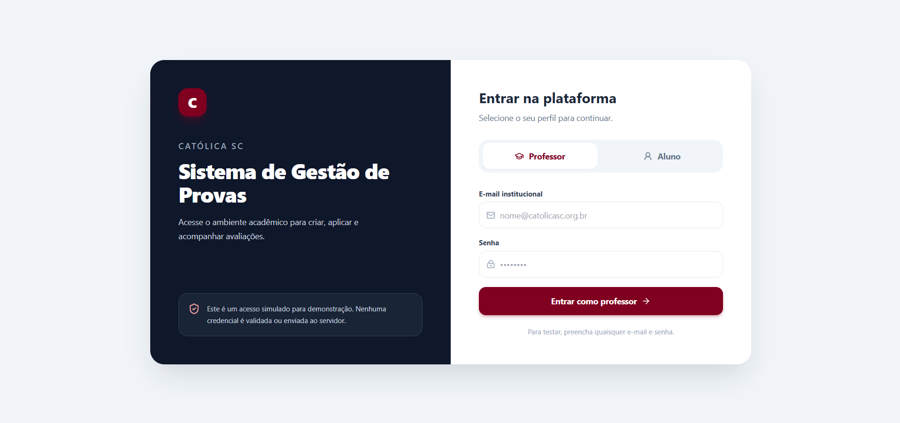
  <p><em>Figura — Interface de Autenticação Institucional Docente</em></p>
</div>

#### 3.2.2 Telas 2 e 3: Cadastros Gerais de Turmas e Discentes
Permite a visualização em abas com cards das disciplinas, código de matrícula rápida para estudantes e tabela completa de alunos com busca instantânea. A consulta ao ViaCEP preenche logradouro, bairro, cidade e UF automaticamente ao informar o código postal.

<div align="center">
  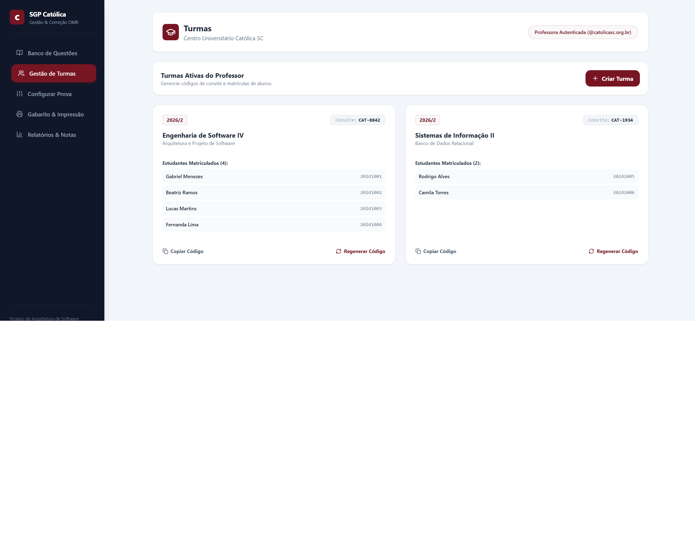
  <p><em>Figura — Painel de Turmas Acadêmicas e Códigos de Convite</em></p>
</div>

<div align="center">
  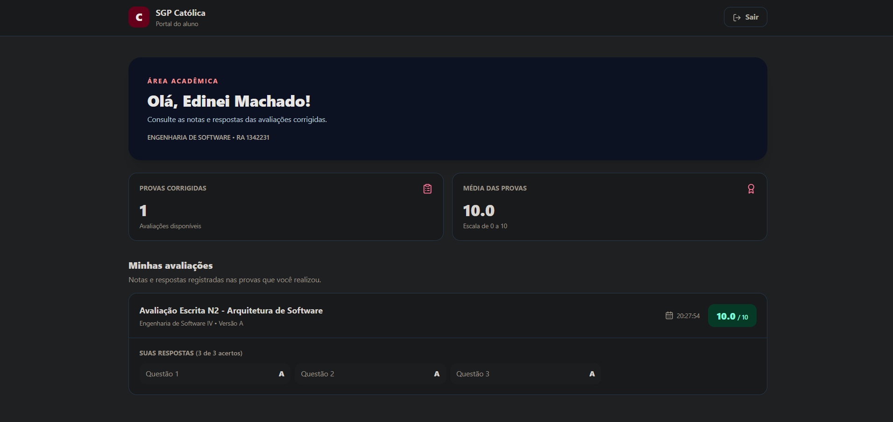
  <p><em>Figura — Tabela de Alunos com Notas N1, N2, N3, Médias e Situação Acadêmica</em></p>
</div>

#### 3.2.3 Tela 4: Montador de Provas em Split-Screen
Apresenta o banco de questões no painel esquerdo com filtros por tags temáticas (`#Arquitetura`, `#PostgreSQL`, `#OMR`). O painel direito totaliza os pontos e impede a adição de mais de 20 questões, permitindo alternar os botões de embaralhamento com algoritmos de semente.

<div align="center">
  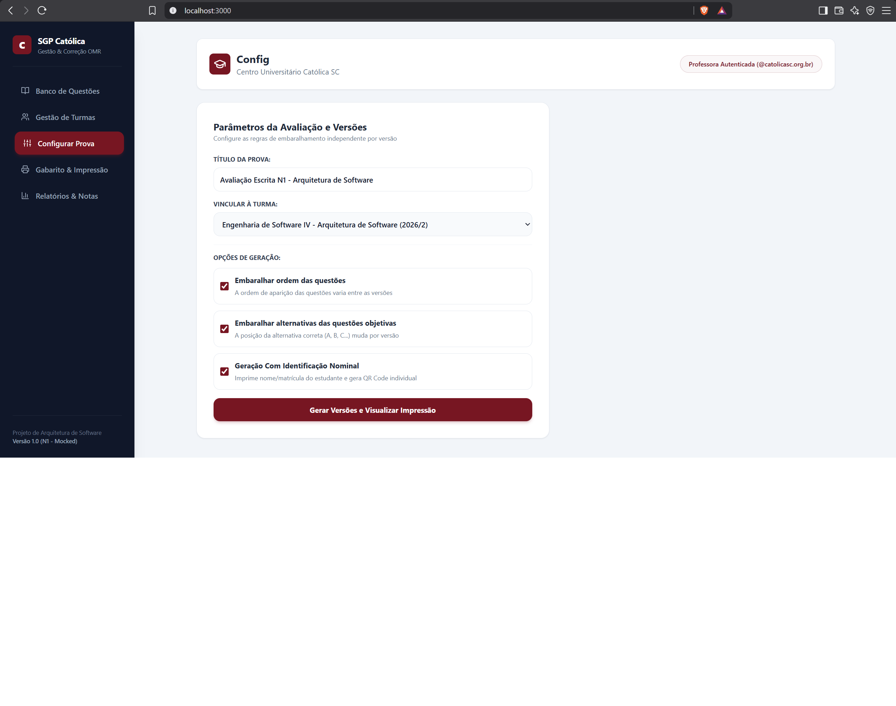
  <p><em>Figura — Montador Split-Screen com Parâmetros de Embaralhamento e Pontuação</em></p>
</div>

<div align="center">
  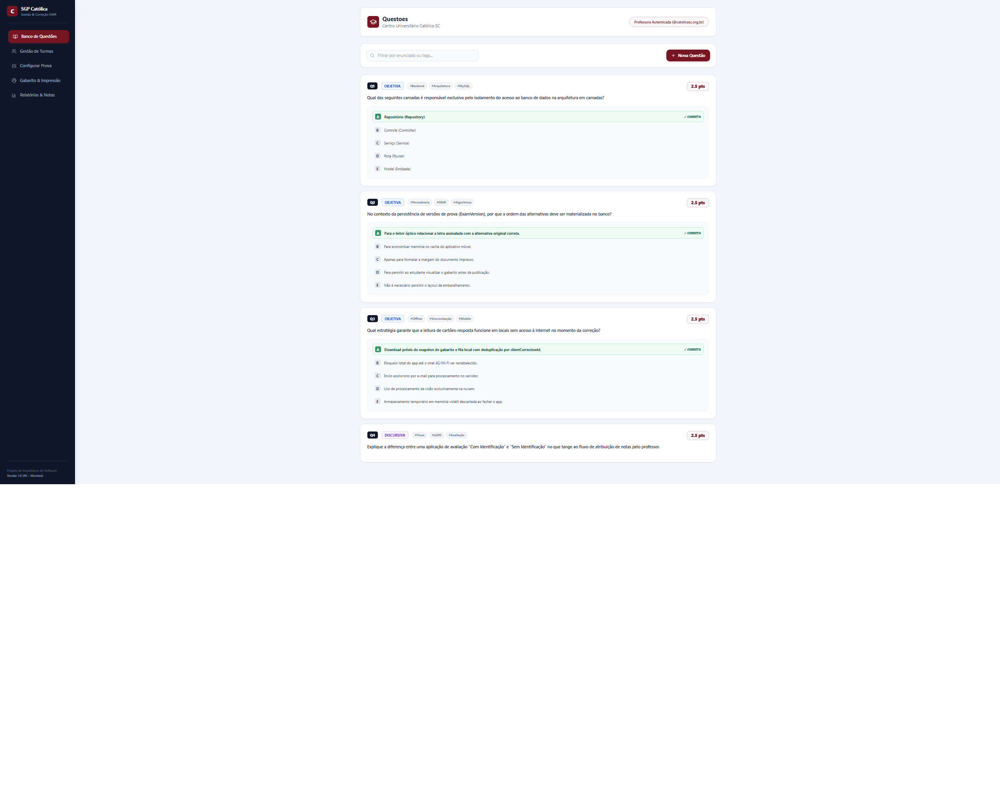
  <p><em>Figura — Modal de Cadastro de Questões Objetivas e Discursivas com Gabarito</em></p>
</div>

#### 3.2.4 Tela 5: Folha de Respostas OMR e Diagramação Frente/Verso
Gera a versão nominal individual de cada discente com QR Code SVG livre de falhas de renderização SSR. A página inclui 4 blocos pretos fiduciais nos vértices e insere uma quebra de página física com verso em branco caso o número de páginas seja ímpar, garantindo que o aluno possa destacar o gabarito sem danificar as questões da prova.

<div align="center">
  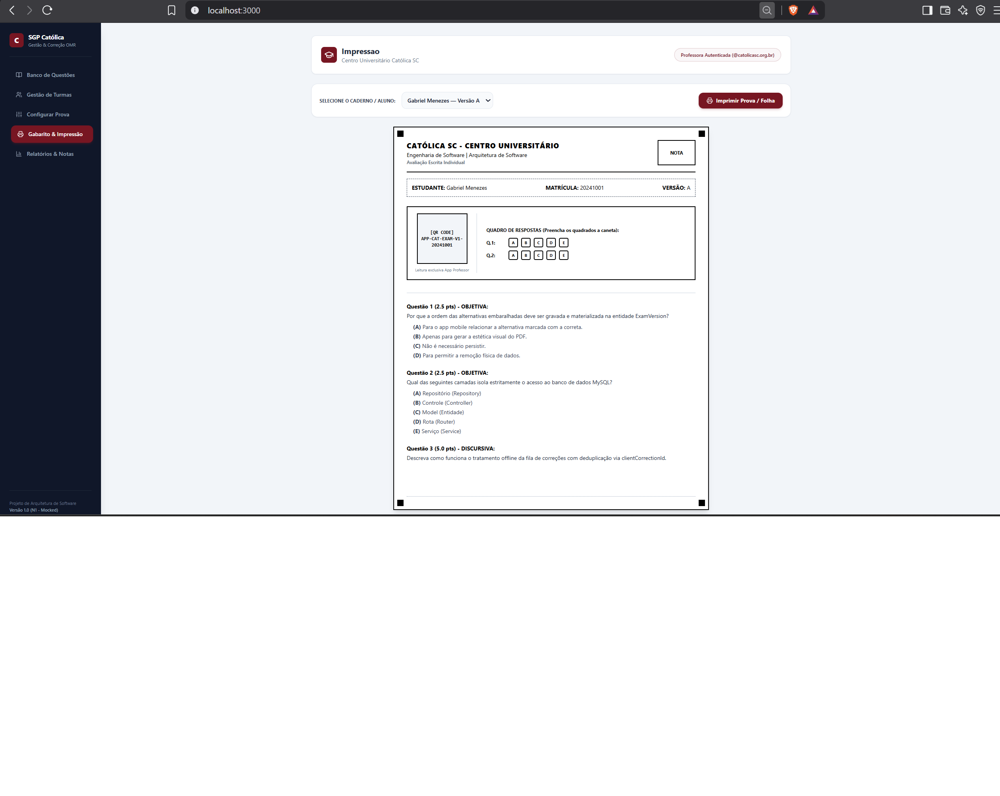
  <p><em>Figura — Gabarito OMR Individual com Marcadores Fiduciais e QR Code Nominal</em></p>
</div>

#### 3.2.5 Telas 6 e 7: Leitura Óptica em Tempo Real e Relatórios de Desempenho
Integra a câmera do dispositivo via biblioteca `html5-qrcode`. Ao enquadrar o cartão-resposta, o sistema decodifica os dados do aluno, calcula os acertos e salva a nota N2 no mesmo instante, emitindo alerta visual verde de confirmação e atualizando os gráficos de distratores e tabelas da turma.

<div align="center">
  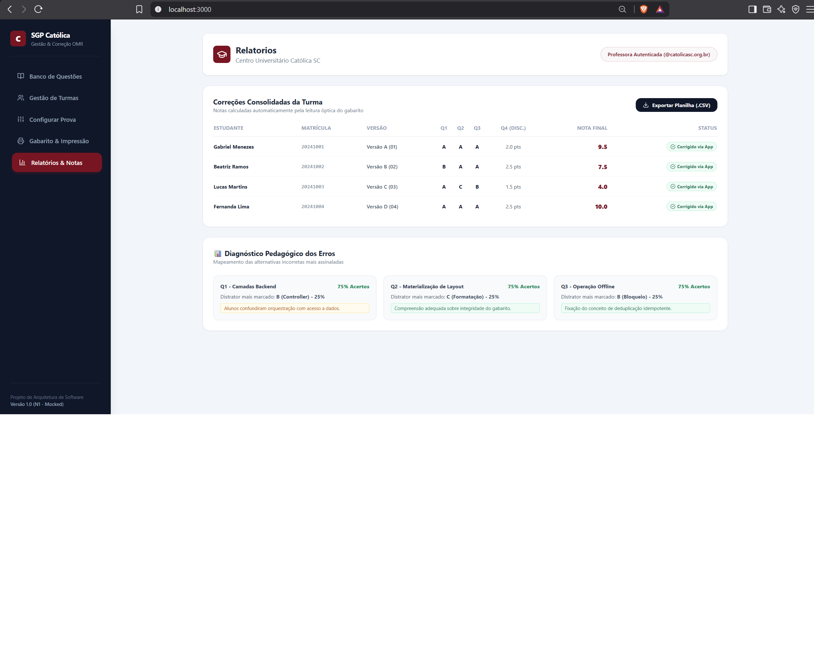
  <p><em>Figura — Painel de Diagnóstico Pedagógico com Análise de Distratores e Exportação</em></p>
</div>

---

## 4. Modelagem Formal UML (Análise Minuciosa dos Diagramas)

A modelagem do sistema foi desenvolvida em conformidade com o padrão internacional **UML 2.5 (OMG)**, assegurando consistência entre os requisitos e as classes implementadas no código-fonte.

---

### 4.1 Diagrama de Casos de Uso (Figura 1)

<div align="center">
  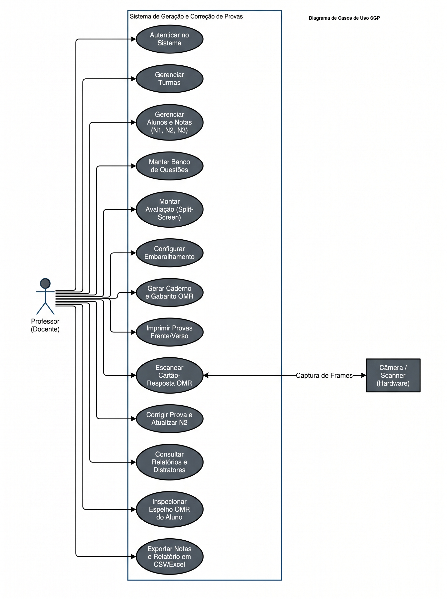
  <p><strong>Figura 1 – Diagrama de Casos de Uso Oficial do Sistema SGP Católica SC</strong> (AUTOR: AGENOR ALVISE)</p>
</div>

#### Análise Dedutiva do Diagrama
* **Fronteira do Sistema (*System Boundary*):** Isola de forma nítida os 13 casos de uso administrativos executados pelo software dos atores externos.
* **Ator Principal — Professor (Docente):** Ator humano que opera ativamente a interface web, sendo o iniciador de todos os fluxos de gestão, montagem, impressão e extração de notas.
* **Ator Secundário — Câmera / Scanner (Hardware):** Ator de periférico físico especializado. Conecta-se diretamente ao caso de uso `Escanear Cartão-Resposta OMR` fornecendo o fluxo contínuo de quadros ópticos (*video frames*).
* **Participação do Estudante:** O discente participa como agente físico externo no ambiente presencial de prova (preenchendo as bolhas a caneta e destacando a folha), não possuindo credenciais de acesso administrativo neste diagrama de gestão.

---

### 4.2 Diagrama de Atividades com Raias Concorrentes (Figura 2)

<div align="center">
  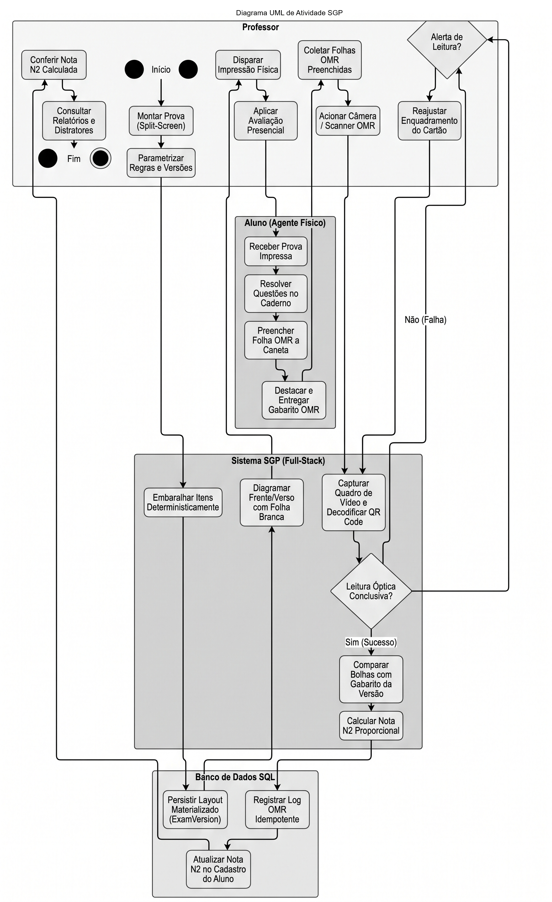
  <p><strong>Figura 2 – Diagrama de Atividades com Raias Concorrentes (Swimlanes)</strong> (AUTOR: EDINEI JUNIO MACHAD)</p>
</div>

#### Análise das 4 Raias Concorrentes (*Swimlanes*)
1. **Raia 1: Professor (Docente):** Inicia o processo no nó inicial (`●`), configura as regras no montador, dispara a impressão física, aplica a prova em sala, recolhe os gabaritos e aciona a câmera para leitura. Finaliza o fluxo inspecionando a nota calculada e consultando relatórios pedagógicos no nó final (`◉`).
2. **Raia 2: Aluno (Agente Físico):** Representa o estudante em sala de aula física resolvendo a avaliação: recebe a prova impressa, resolve as questões no caderno, preenche as bolhas da folha OMR a caneta, destaca o gabarito e entrega-o ao docente, retendo o caderno de questões para estudo.
3. **Raia 3: Sistema SGP (Full-Stack):** Executa o embaralhamento determinístico, diagramação frente/verso com folha em branco, captura de frames da câmera e decodificação do QR Code. Possui um nó de decisão crítico (`Leitura Óptica Conclusiva?`):
   * **[Sim (Sucesso)]:** Compara as bolhas com o gabarito oficial da versão lida e calcula a nota proporcional N2;
   * **[Não (Falha)]:** Dispara alerta sonoro/visual para que o professor reenquadre o cartão em frente à lente da câmera.
4. **Raia 4: Banco de Dados SQL:** Garante a atomicidade transacional e persistência: materializa os layouts das versões geradas, grava os logs de leitura OMR de forma idempotente e atualiza imediatamente a nota N2 no cadastro do aluno.

---

### 4.3 Diagrama de Classes de Domínio e Associações (Figura 3)

<div align="center">
  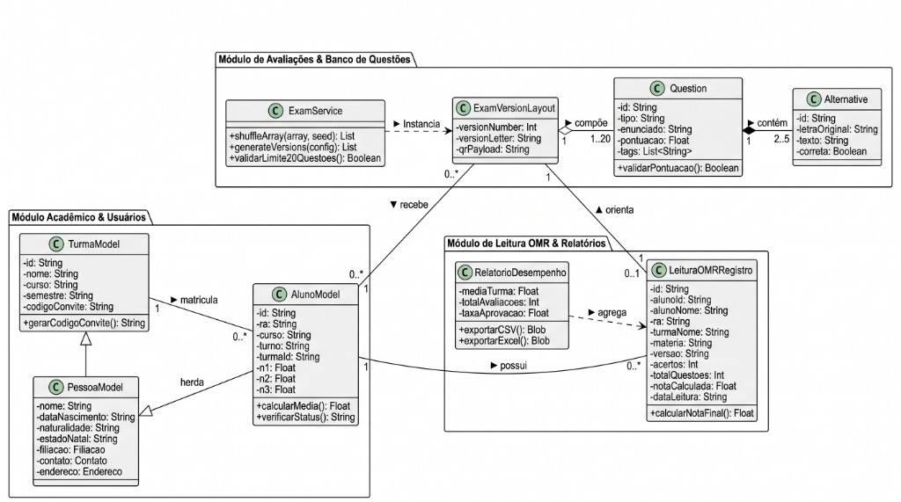
  <p><strong>Figura 3 – Diagrama de Classes de Domínio e Associações do SGP</strong> (AUTOR: ERIC RICARDO LANGE )</p>
</div>

#### Análise Estrutural das Entidades e Relacionamentos
* **Herança (Generalização):** `AlunoModel` herda todos os atributos de identificação civil, contato e morada de `PessoaModel`, especializando-se com campos acadêmicos (`ra`, `curso`, `turno`, `n1`, `n2`, `n3`) e métodos de negócio (`calcularMedia()`, `verificarStatus()`).
* **Associação `TurmaModel` e `AlunoModel` (`1` para `0..*`):** Uma turma acadêmica congrega múltiplos estudantes matriculados sob o método `gerarCodigoConvite()`.
* **Serviço de Domínio `ExamService`:** Fornece as operações `shuffleArray(array, seed)`, `generateVersions(config)` e a validação de negócio `validarLimite20Questoes() : Boolean`. Possui dependência de criação com `ExamVersionLayout`.
* **Composição `ExamVersionLayout` e `Question` (`1` para `1..20`):** Cada versão física materializada é composta obrigatoriamente por 1 a 20 questões. A destruição da versão desfaz o vínculo do caderno.
* **Composição `Question` e `Alternative` (`1` para `2..5`):** Toda questão objetiva é composta estritamente por 2 a 5 alternativas de múltipla escolha.
* **Associação `AlunoModel` e `LeituraOMRRegistro` (`1` para `0..*`):** O estudante acumula um histórico cronológico de leituras ópticas de suas provas.
* **Orientação de Leitura (`ExamVersionLayout` para `LeituraOMRRegistro`):** A leitura de cada gabarito é orientada pela matriz da versão decodificada no QR Code.
* **Agregação `RelatorioDesempenho` e `LeituraOMRRegistro` (`1` para `0..*`):** O relatório agrega os registros de leituras individuais para calcular a média da turma, taxa de aprovação e gerar relatórios em CSV e Excel.

---

### 4.4 Diagrama de Sequência — Leitura OMR e Atualização N2 (Figura 4)

<div align="center">
  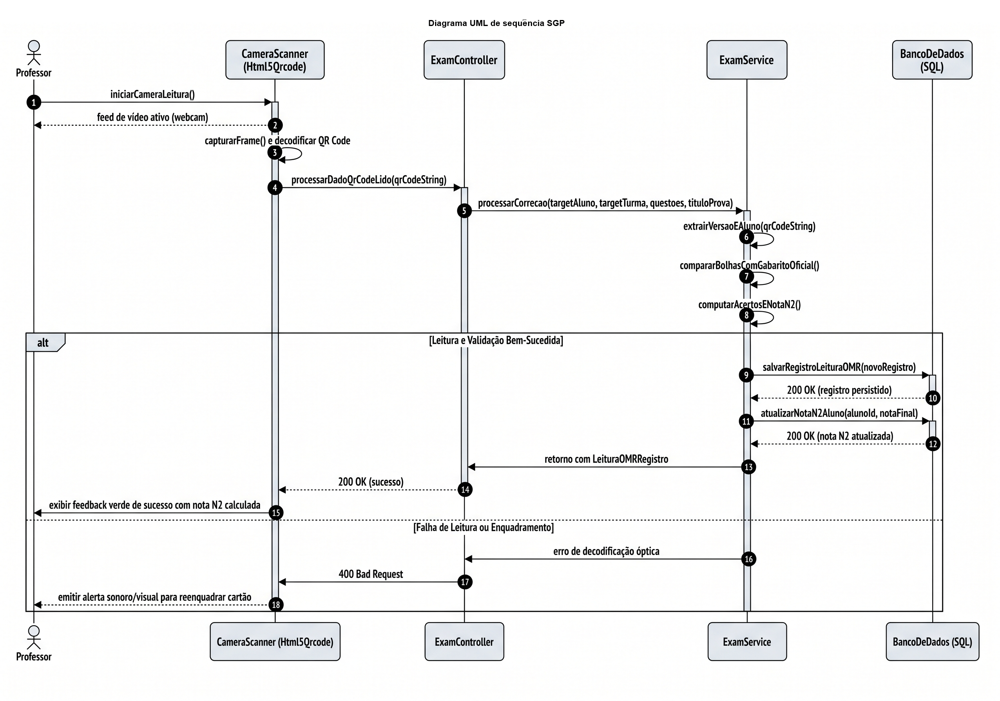
  <p><strong>Figura 4 – Diagrama de Sequência UML: Leitura Óptica, Correção e Atualização da Nota N2</strong> (AUTOR: ERICK ANDREAS PONTECELLI )</p>
</div>

#### Cronologia e Intercâmbio de Mensagens (1 a 18)
1. **Passo 1-2:** O `Professor` aciona `iniciarCameraLeitura()` e o componente `CameraScanner (Html5Qrcode)` inicia o feed de vídeo da webcam.
2. **Passo 3-4:** O scanner executa a captura contínua de quadros (`capturarFrame()`), detecta o QR Code e despacha `processarDadoQrCodeLido(qrCodeString)`.
3. **Passo 5-8:** O scanner chama `processarCorrecao(...)` no `ExamController`, que delega ao `ExamService` a extração da versão/RA, comparação das bolhas assinaladas com o gabarito oficial e cômputo dos acertos e nota N2.
4. **Bloco Alternativo (`alt`) — [Leitura e Validação Bem-Sucedida]:**
   * **Passo 9-10:** O serviço comanda `salvarRegistroLeituraOMR(novoRegistro)` e o banco SQL retorna confirmação `200 OK`.
   * **Passo 11-12:** O serviço executa `atualizarNotaN2Aluno(alunoId, notaFinal)` e o banco confirma a atualização.
   * **Passo 13-15:** O serviço retorna o modelo de leitura ao controller, que repassa `200 OK` ao scanner e exibe o feedback visual verde de sucesso com a nota calculada na tela do professor.
5. **Bloco Alternativo (`alt`) — [Falha de Leitura ou Enquadramento]:**
   * **Passo 16-18:** Ocorrendo erro de iluminação ou decodificação, o serviço emite erro óptico, o controller responde `400 Bad Request` e a interface emite alerta sonoro/visual orientando o docente a reenquadrar o cartão.

---

## 5. Especificação Formal de Casos de Uso (Padrão IEEE 830)

### 5.1 Matriz Geral de Casos de Uso (UC01 a UC15)

| Identificador | Título do Caso de Uso | Ator Principal | Atores Secundários | Tipo de Relacionamento |
|:---:|---|---|---|---|
| **UC01** | Autenticar no Sistema | Professor / Aluno | Provedor SSO / Local | — |
| **UC02** | Gerenciar Banco de Questões | Professor | Sistema SGP | Manutenção CRUD |
| **UC03** | Gerenciar Turmas | Professor | Sistema SGP | Gestão de `inviteCode` |
| **UC04** | Configurar Avaliação | Professor | Sistema SGP | Seleção e Parametrização |
| **UC05** | Gerar Versões da Avaliação | Professor | Motor SGP | `<<include>>` UC09 |
| **UC06** | Imprimir Caderno Frente/Verso | Professor | Sistema / Impressora | Regras `@media print` |
| **UC07** | Gerar Folha OMR | Professor | Gerador Zxing | `<<include>>` UC10 |
| **UC08** | Visualizar Relatórios e Histórico | Professor / Aluno | Sistema SGP | `<<extend>>` UC11 |
| **UC09** | Embaralhamento Determinístico | Sistema | — | Incluso em UC05 (Fisher-Yates) |
| **UC10** | Gerar QR Code Identificador | Sistema | — | Incluso em UC07 |
| **UC11** | Análise Estatística de Distratores | Professor | Sistema SGP | Extensão de UC08 |
| **UC12** | Exportar Dados em Planilha (CSV) | Professor | Sistema SGP | Exportação de Histórico |
| **UC13** | Autocadastro de Aluno em Turma | Aluno | Sistema SGP | Consumo de `inviteCode` |
| **UC14** | Validar Código de Turma | Aluno / Sistema | Banco de Dados | Consulta de Vínculo |
| **UC15** | Consultar Boletim de Notas (N1/N2/N3) | Aluno | Sistema SGP | Acompanhamento Discente |

### 5.2 Fronteira do Sistema e Relacionamentos

```text
===================================================================================
                       SISTEMA SGP — FRONTEIRA DO SISTEMA
===================================================================================
  [ PROFESSOR ]                                                      [ ALUNO ]
 (@catolicasc.org.br)                                          (@catolicasc.edu.br)
         |                                                               |
         +------> ( UC01: Autenticar no Sistema ) <----------------------+      
         |                                                               |
         +------> ( UC02: Gerenciar Banco de Questões )                  |
         |                                                               |
         +------> ( UC03: Gerenciar Turmas )                             |
         |                                                               |
         +------> ( UC04: Configurar Avaliação )                         |
         |                                                               |
         +------> ( UC05: Gerar Versões da Avaliação )                   |
         |               |                                               |
         |               +---<<include>>---> ( UC09: Fisher-Yates )      |
         |                                                               |
         +------> ( UC06: Imprimir Caderno Frente/Verso )                 |
         |                                                               |
         +------> ( UC07: Gerar Folha OMR )                              |
         |               |                                               |
         |               +---<<include>>---> ( UC10: Gerar QR Code )     |
         |                                                               |
         +------> ( UC08: Visualizar Relatórios (N1/N2/N3) ) <-----------+
                         ^                                               |
                         |                                               |
                         +---<<extend>>---- ( UC11: Distratores )        |
                                                                         |
         +---------------------------------------------------------------+
         |                                                                
         v                                                                
  ( UC14: Validar Código de Turma ) <------------------------------------+
===================================================================================
```

### 5.3 Catálogo Detalhado com Fluxos Principais e de Exceção

#### UC01: Autenticar no Sistema
* **Atores:** Professor, Aluno.
* **Fluxo Principal:** O usuário informa e-mail e credenciais institucionais. O sistema valida o domínio (`@catolicasc.org.br` para Docentes ou `@catolicasc.edu.br` para Alunos), armazena a sessão e direciona o usuário para o dashboard do seu respectivo perfil.
* **Fluxo de Exceção:** E-mail sem o formato válido ou credenciais divergentes. O sistema exibe alerta e bloqueia a navegação.

#### UC04: Configurar Avaliação
* **Atores:** Professor.
* **Fluxo Principal:** O docente seleciona a turma, informa o título da prova, adiciona até 20 questões do banco e ativa os parâmetros de embaralhamento de questões e alternativas.
* **Fluxo de Exceção:** O docente tenta inserir mais de 20 questões. O sistema emite mensagem de bloqueio e desativa a inclusão de novos itens.

#### UC05: Gerar Versões da Avaliação (com inclusão do UC09)
* **Atores:** Professor, Sistema SGP.
* **Fluxo Principal:** O sistema itera sobre a lista de alunos da turma, gera uma semente numérica única por versão e invoca compulsoriamente o **UC09 (Fisher-Yates)** para permutar deterministicamente as questões e as alternativas, materializando a matriz da versão.

#### UC07: Gerar Folha OMR (com inclusão do UC10)
* **Atores:** Professor, Sistema SGP.
* **Fluxo Principal:** O sistema constrói a grade de marcação de respostas A–E, desenha os marcadores de calibração nos vértices e invoca compulsoriamente o **UC10 (Gerar QR Code)** para renderizar o código SVG com matrícula, RA, turma e versão.

#### UC08: Visualizar Relatórios e Histórico (com extensão ao UC11)
* **Atores:** Professor, Aluno.
* **Fluxo Principal:** Exibe tabela longitudinal das etapas N1, N2 e N3 com o cálculo da média semestral e situação acadêmica. Caso o docente clique em uma questão objetiva, o sistema aciona condicionalmente o **UC11 (Análise Estatística de Distratores)** para exibir a frequência de marcação das opções incorretas.

### 5.4 Matriz de Controle de Acesso Baseada em Papéis (RBAC)

| Papel / Perfil | Domínio Permitido | Casos de Uso com Permissão Total |
|---|---|---|
| **Professor** | `@catolicasc.org.br` | UC01, UC02, UC03, UC04, UC05, UC06, UC07, UC08, UC11, UC12 |
| **Aluno** | `@catolicasc.edu.br` | UC01, UC08, UC13, UC14, UC15 |
| **Processo Interno** | Sistema Local | UC09, UC10 |

---

## 6. Projeto de Persistência Relacional SQL (3FN)

### 6.1 Justificativa Técnica da Transição para PostgreSQL
Para atender às demandas reais de centenas de estudantes e manter histórico auditável das avaliações, o SGP modelou sua persistência em um banco de dados relacional **PostgreSQL**, estruturado em Terceira Forma Normal (**3FN**). O modelo resolve:
* **Persistência Determinística:** Materialização da ordem sorteada nas tabelas `questoes_versao` e `alternativas_versao`, permitindo recalcular gabaritos a qualquer momento sem depender de cache volátil;
* **Garantia de Idempotência:** Chave única `client_correction_id` na tabela `leituras_omr`, impedindo duplicidade caso o leitor escaneie a mesma folha repetidamente ou reconecte após queda de sinal;
* **Integridade Referencial:** Chaves estrangeiras com deleção em cascata controlada (`ON DELETE CASCADE`), mantendo a consistência dos dados cadastrais.

### 6.2 DDL Completo das Tabelas Relacionais (`schema-n2.sql`)

```sql
-- ============================================================================
-- CENTRO UNIVERSITÁRIO CATÓLICA DE SANTA CATARINA
-- SISTEMA DE GERAÇÃO E CORREÇÃO DE PROVAS (SGP CATÓLICA)
-- Script DDL Oficial de Criação do Banco de Dados Relacional PostgreSQL (3FN)
-- ============================================================================

CREATE EXTENSION IF NOT EXISTS "uuid-ossp";

-- 1. Tabela de Usuários / Corpo Docente
CREATE TABLE usuarios (
    id UUID PRIMARY KEY DEFAULT uuid_generate_v4(),
    nome VARCHAR(150) NOT NULL,
    email VARCHAR(150) UNIQUE NOT NULL,
    senha_hash VARCHAR(255) NOT NULL,
    perfil VARCHAR(20) NOT NULL DEFAULT 'docente' CHECK (perfil IN ('docente', 'administrador')),
    criado_em TIMESTAMP WITH TIME ZONE DEFAULT CURRENT_TIMESTAMP
);

-- 2. Tabela de Turmas Acadêmicas
CREATE TABLE turmas (
    id UUID PRIMARY KEY DEFAULT uuid_generate_v4(),
    nome VARCHAR(100) NOT NULL,
    curso VARCHAR(100) NOT NULL,
    semestre VARCHAR(10) NOT NULL,
    codigo_convite VARCHAR(20) UNIQUE NOT NULL,
    docente_id UUID NOT NULL REFERENCES usuarios(id) ON DELETE RESTRICT,
    criado_em TIMESTAMP WITH TIME ZONE DEFAULT CURRENT_TIMESTAMP
);

-- 3. Tabela de Alunos (com Herança Conceitual de Pessoa)
CREATE TABLE alunos (
    id UUID PRIMARY KEY DEFAULT uuid_generate_v4(),
    turma_id UUID REFERENCES turmas(id) ON DELETE SET NULL,
    ra VARCHAR(20) UNIQUE NOT NULL,
    nome VARCHAR(150) NOT NULL,
    data_nascimento DATE,
    naturalidade VARCHAR(100),
    estado_natal CHAR(2),
    filiacao_mae VARCHAR(150),
    filiacao_pai VARCHAR(150),
    email VARCHAR(150),
    celular VARCHAR(20),
    cep CHAR(8),
    logradouro VARCHAR(150),
    numero VARCHAR(20),
    bairro VARCHAR(100),
    cidade VARCHAR(100),
    estado CHAR(2),
    curso VARCHAR(100) NOT NULL,
    turno VARCHAR(20) NOT NULL DEFAULT 'Noturno',
    nota_n1 NUMERIC(4,2) DEFAULT 0.00 CHECK (nota_n1 BETWEEN 0 AND 10),
    nota_n2 NUMERIC(4,2) DEFAULT 0.00 CHECK (nota_n2 BETWEEN 0 AND 10),
    nota_n3 NUMERIC(4,2) DEFAULT 0.00 CHECK (nota_n3 BETWEEN 0 AND 10),
    criado_em TIMESTAMP WITH TIME ZONE DEFAULT CURRENT_TIMESTAMP
);

-- 4. Banco de Questões
CREATE TABLE questoes (
    id UUID PRIMARY KEY DEFAULT uuid_generate_v4(),
    docente_id UUID NOT NULL REFERENCES usuarios(id) ON DELETE RESTRICT,
    tipo VARCHAR(20) NOT NULL CHECK (tipo IN ('objetiva', 'discursiva')),
    enunciado TEXT NOT NULL,
    pontuacao NUMERIC(4,2) NOT NULL DEFAULT 2.50 CHECK (pontuacao > 0),
    tags TEXT[],
    criado_em TIMESTAMP WITH TIME ZONE DEFAULT CURRENT_TIMESTAMP
);

-- 5. Alternativas de Questões Objetivas
CREATE TABLE alternativas (
    id UUID PRIMARY KEY DEFAULT uuid_generate_v4(),
    questao_id UUID NOT NULL REFERENCES questoes(id) ON DELETE CASCADE,
    letra_original CHAR(1) NOT NULL CHECK (letra_original IN ('A', 'B', 'C', 'D', 'E')),
    texto TEXT NOT NULL,
    correta BOOLEAN NOT NULL DEFAULT FALSE,
    CONSTRAINT uk_questao_letra UNIQUE (questao_id, letra_original)
);

-- 6. Avaliações
CREATE TABLE avaliacoes (
    id UUID PRIMARY KEY DEFAULT uuid_generate_v4(),
    turma_id UUID NOT NULL REFERENCES turmas(id) ON DELETE CASCADE,
    titulo VARCHAR(150) NOT NULL,
    embaralhar_questoes BOOLEAN NOT NULL DEFAULT TRUE,
    embaralhar_alternativas BOOLEAN NOT NULL DEFAULT TRUE,
    com_identificacao_nominal BOOLEAN NOT NULL DEFAULT TRUE,
    criado_em TIMESTAMP WITH TIME ZONE DEFAULT CURRENT_TIMESTAMP
);

-- 7. Versões Físicas Materializadas da Avaliação
CREATE TABLE versoes_avaliacao (
    id UUID PRIMARY KEY DEFAULT uuid_generate_v4(),
    avaliacao_id UUID NOT NULL REFERENCES avaliacoes(id) ON DELETE CASCADE,
    aluno_id UUID REFERENCES alunos(id) ON DELETE SET NULL,
    numero_versao INT NOT NULL,
    letra_versao CHAR(1) NOT NULL,
    semente_utilizada BIGINT NOT NULL,
    qr_payload TEXT NOT NULL,
    criado_em TIMESTAMP WITH TIME ZONE DEFAULT CURRENT_TIMESTAMP
);

-- 8. Disposição Física das Questões na Versão
CREATE TABLE questoes_versao (
    id UUID PRIMARY KEY DEFAULT uuid_generate_v4(),
    versao_id UUID NOT NULL REFERENCES versoes_avaliacao(id) ON DELETE CASCADE,
    questao_id UUID NOT NULL REFERENCES questoes(id) ON DELETE RESTRICT,
    posicao_ordem INT NOT NULL CHECK (posicao_ordem BETWEEN 1 AND 20),
    CONSTRAINT uk_versao_posicao UNIQUE (versao_id, posicao_ordem)
);

-- 9. Disposição Física das Alternativas na Versão
CREATE TABLE alternativas_versao (
    id UUID PRIMARY KEY DEFAULT uuid_generate_v4(),
    versao_id UUID NOT NULL REFERENCES versoes_avaliacao(id) ON DELETE CASCADE,
    questao_id UUID NOT NULL REFERENCES questoes(id) ON DELETE RESTRICT,
    alternativa_id UUID NOT NULL REFERENCES alternativas(id) ON DELETE RESTRICT,
    letra_exibida CHAR(1) NOT NULL CHECK (letra_exibida IN ('A', 'B', 'C', 'D', 'E')),
    CONSTRAINT uk_versao_questao_letra UNIQUE (versao_id, questao_id, letra_exibida)
);

-- 10. Leituras Ópticas OMR e Correções Efetuadas
CREATE TABLE leituras_omr (
    id UUID PRIMARY KEY DEFAULT uuid_generate_v4(),
    client_correction_id VARCHAR(100) UNIQUE NOT NULL,
    versao_id UUID NOT NULL REFERENCES versoes_avaliacao(id) ON DELETE RESTRICT,
    aluno_id UUID NOT NULL REFERENCES alunos(id) ON DELETE RESTRICT,
    total_questoes INT NOT NULL,
    acertos INT NOT NULL,
    nota_calculada NUMERIC(4,2) NOT NULL CHECK (nota_calculada BETWEEN 0 AND 10),
    data_leitura TIMESTAMP WITH TIME ZONE DEFAULT CURRENT_TIMESTAMP
);

-- 11. Espelho Detalhado de Respostas Escaneadas
CREATE TABLE respostas_leitura (
    id UUID PRIMARY KEY DEFAULT uuid_generate_v4(),
    leitura_id UUID NOT NULL REFERENCES leituras_omr(id) ON DELETE CASCADE,
    numero_questao INT NOT NULL,
    letra_assinalada CHAR(1) NOT NULL CHECK (letra_assinalada IN ('A', 'B', 'C', 'D', 'E')),
    acertou BOOLEAN NOT NULL
);
```

---

## 7. Governança Git, Diário de Bordo e Evidências do GitHub Actions

### 7.1 Histórico de Execuções e Auditoria do Pipeline CI/CD

O repositório do projeto adota esteira contínua de Integração e Entrega Contínua (CI/CD) gerenciada pelo **GitHub Actions** (`SGP Católica CI/CD Pipeline`)